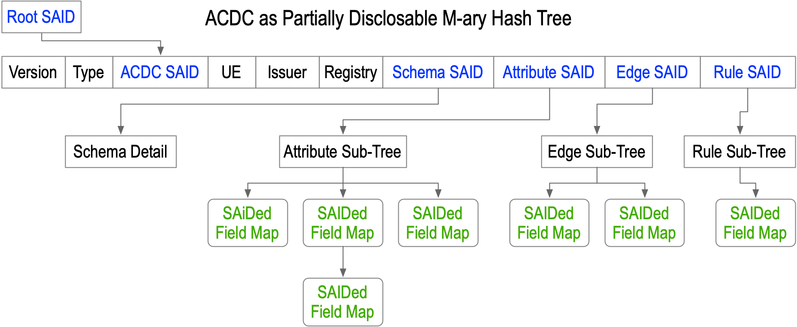

# SEDI Implementation Guide

version 0.2.3  2026/10/23

## Introduction
The term ACDC stands for Authentic Chained Data Container. It is the supporting format and protocol used for SEDI. The ACDC protocol is an open standard with open-source tooling. The ACDC specification is dependent on and leverages both the KERI and CESR specifications. The specifications may be found here [ACDC Specification](https://trustoverip.github.io/kswg-acdc-specification/), [KERI Specification](https://trustoverip.github.io/kswg-keri-specification/), and [CESR Specification](https://trustoverip.github.io/kswg-cesr-specification/). Working code that generates the schemas and ACDC examples can be found here [Working example generation code](https://github.com/WebOfTrust/keripy/tree/main/tests/sedi).

In this guide, the term *citizen* refers to persons issued State Endorsed Digital Identity (SEDI) entitlements. In some cases, a *citizen* may not technically be a citizen but may be a visitor or have temporary residence status.  The term *citizen* is used generically to refer to anyone who receives a SEDI, i.e., a citizen-sourced, state-endorsed digital identity. When more specificity is required, the guild will further qualify the citizen status. Fields in a citizen's core identity ACDC provide their citizenship status. The term *State* (capitalized) refers to the *State of Utah* or another state running a SEDI program using the ACDCs outlined in this guide. An *entitlement* generally refers to an ACDC issued by the State or one of its delegated agents. An entitlement may be a credential or license or some other instrument. 

The key detail in SEDI is that the citizen's identifier is an AID (autonomic IDentifier) that the citizen fully controls. An AID is a cryptographically derived pseudonym or cryptonym for short. Control over the AID cryptonym is via private cryptographic keys. Whoever controls the keys controls the identifier. Euphemistically, AIDs support the concept of "my keys, my identity or not my keys, not my identity". This requires citizens to manage their keys. KERI (Key Event Receipt Infrastructure) is an open protocol that lets any entity fully control its identity (identifiers) through a fault-tolerant, decentralized key management infrastructure. ACDCs are built on top of KERI. 

The State and its agents all have their own AIDs. They use these to issue entitlements to citizens.
A citizen can then present a State-issued entitlement to a 2nd party, which can cryptographically verify that the State authentically issued it and that the citizen authentically presented it.

KERI and ACDCs support two unique, vitally important properties for SEDI. These are *perpetual identity* and *perpetually verifiable issuance*.  

*Perpetual identity* means that the controller of the identifier(s) (AIDs) associated with that identity can maintain control in perpetuity despite continuing rotations of the keys that control those identifier(s) (AIDs). This property enables true decentralization of digital identity. True perpetual identity means a citizen does not rely on or remain beholden to trusted third parties (such as the State) to create and maintain control over their own digital identity. 

*Perpetually verifiable issuance* means that an issuing entity such as the State can issue an endorsement from their identifier(s) (AIDs) that refer to a citizen's identifier(s) (AIDs) where such endorsement may be verified by some party in perpetuity despite continuing rotations of the issuer's keys that control their own identifiers (AIDs). This property enables persistent entitlements whose lifespan is not limited by the cryptoperiod (lifespan) of their cryptographic keys. Once issued, a citizen can use the entitlement without continuing reliance on the State. This removes the centralizing force of entitlements that must be reissued on short time scales determined by the cryptoperiod of the issuer keys, not the entitlement's legal requirements. Such cryptoperiod-driven reissuance essentially forces citizens to keep interacting with, and relying on, the State to use the entitlements. Such reliance would effectively defeat citizen control over their digital identity. Therefore, such reliance would conflict with the legal requirements set forth in the SEDI legislation. 

Importantly, perpetually verifiable issuance implies that the issuance may be authenticated in perpetuity and that any entitlement issued, such as authorization to access resources, may also be verified in perpetuity. This perpetual verifiability of authentic issuance is independent of the authorization's active period. An entitlement may expire or be revoked, but its authentic issuance remains verifiable despite key rotations. In contrast, issuances whose authenticity depends on a given key state (and therefore does not survive a key rotation) are vulnerable to forgery should the key be compromised and therefore have, at best, ephemeral authenticity.

## Root-of-Trust and Chain-of-Authority

The State will establish a special AID that provides the root-of-trust for the SEDI ecosystem. This AID will be published in several well-known locations under the control of the State (locus of control). Once published, an attacker cannot substitute a different AID for the root of trust without also compromising the State's control over all the well-known locations. We call this special AID the *Root AID* or RAID.  

The Root AID can then delegate authority to other AIDs under the control of State Organizational Units to perform their duties under the SEDI program. These Organizational Unit AIDs can further delegate authority to other AIDs under the control of Issuing Agents to perform their duties under the SEDI program. The primary duty of Issuing Agents is to issue SEDI entitlements to citizens. In some cases, such as guardianship, the Issuing Agents may further delegate authority to Citizens as Guardians over Wards. This delegable facility models the State's current legal duties and roles with respect to its citizens in the context of digital identity. It does not replace the legal structure but enables it to operate electronically with high fidelity and security.

ACDCs normatively support relationships through cryptographically verifiable edges or links to other ACDCs. These relationships can represent delegation hierarchies. Thus, a specific delegation of authority expressed with an ACDC is a verifiable digital credential whose metes and bounds are cryptographically provable. A delegation hierarchy is composed of linked delegations. Revoking any link in the chain can break the chain of authority. This closely models how real-world organizations delegate authority. The SEDI program leverages this feature. 

An ACDC as a delegation has an Issuer AID and an Issuee AID. The Issuer is the Delegator, and the Issuee is the Delegatee. The ACDC type determines what authority is delegated. The ACDC fields designate the AIDs of the Delegator and Delegatee. The underlying KERI/ACDC infrastructure makes that delegation perpetually verifiable. When a Delegatee in turn acts as a Delegator, it proves its authority by chaining its delegations back to the chain-of-authority by which it was granted its own authority. This chain of ACDCs is held by the Issuee (Delegatee) in their wallet. At the point of use, they can produce a perpetually verifiable proof of issuance without relying on continued interaction with any Issuer in that chain. This more precisely models how paper-credential-based delegations of authority work in the real world.

The following diagram shows the SEDI chain of authority, the associated AIDs for each party, and the ACDCs in that issuance chain. The schema for these ACDCs is given in a later section. 

### Diagram of Chain-of-Authority to Core Identity


### Diagram of Chain-of-Authority to Guardianship Delegation


### Identity Assurance Process

One primary value the SEDI program provides to its citizens and, by association, the ecosystem of activities, both public and private, is an identity assurance mechanism. Currently, the State provides identity assurance for some issuances, such as driver's licenses. Trust in the SEDI program starts with a high-quality identity assurance process to establish which natural person is the controller of a given AID so endorsed by the SEDI program. The cost of this identity assurance may be amortized over the lifetime of that natural person because the properties of the KERI protocol enable that natural person's control over the AID to be perpetually provable in a fault-tolerant manner. 

This fixes the economics of identity assurance. High-quality identity assurance is expensive. This makes frequent high-quality identity re-assurance or refresh unsustainable from a cost perspective. Thus, any digital identity system that relies on frequent refresh of its identity assurance as a result of the rotation of its cryptographic keys (i.e., non-perpetual), such as the DNS/CA, faces a dilemma of either unsustainable costs or insecurity resulting from low-quality renewal every time keys are rotated. Amortizing the lifetime cost of high-quality identity assurance builds trust in the SEDI ecosystem. 

The SEDI program for a given Citizen begins with a [NIST IAL3](https://pages.nist.gov/800-63-3/sp800-63a.html) identity assurance proofing session. The identity assurance proofing agent is a State-delegated agent. The final step in the IAL3 proofing session is for the Citizen to provide proof of control over their AID. In this case, the AID is the primary AID the Citizen chooses to use when managing their SEDI. To protect against a MITM (Man-In-The-Middle) attack, this AID must be transmitted Out-Of-Band (OOB) from the Citizen to the proofing agent. The OOB transmission is with respect to surveillable networks such as the Internet, WiFi, or Bluetooth. Acceptable OOB transmission mechanisms include optical (via QR code), audible (via oral reading), near-field communication, or equivalent.

The proofing agent then transmits a high-entropy cryptographic challenge code to the Citizen. The Citizen responds by anchoring that challenge code in the KEL (Key Event Log) of the Citizen's AID that the proofing agent previously received OOB. 

This anchor proves both the Citizen's current control over the AID and makes a fraudulent session resulting from a compromise of the Citizen's controlling keys detectable by the Citizen. 

The proving agent then issues the Citizen a receipt with the proven attributes. The proving agent then submits the receipt to the State for further validation. The Citizen can then later present the receipt to a State-delegated Issuing Agent to request issuance of its SEDI entitlements. The State re-verifies that the challenge has been anchored in the Citizen's KEL.  

In the event that the Citizen's keys controlling its AID were compromised, thereby enabling an imposter to successfully satisfy the challenge in a fraudulent proofing session via a forged challenge anchor in the Citizen's KEL for its AID, the anchor requirement enables the Citizen to detect the compromise via an unexpected anchor appearing in its KEL. Upon detection, the Citizen can invalidate the fraudulent anchor via a recovery rotation and prevent the attacker from later successfully presenting the fraudulently obtained receipt to obtain verifiable but fraudulent SEDI entitlements in that citizen's name. 

Once the initial IAL3 proofing session is complete, further refreshes of the citizen's core identity can be much simpler because they don't require presenting physical evidence supporting the core identity from original sources. Typically, the refresh will be for the facial image biometric, which must be refreshed every few years to account for changes in appearance. This minimizes identity assurance costs without sacrificing security. The citizen's residence address is provided in a separate linked ACDC that can be updated independently of the core identity ACDC. Likewise, a proof-of-age ACDC that does not disclose the Citizen's birthdate is also provided in a separate linked ACDC so updates to proof-of-age thresholds can occur without requiring reissuance of the core identity ACDC.

The schema along with an example ACDC for the IAL3 proofing session receipt is provided in a later section.

## Infrastructure

### KERI Infrastructure


### ACDC Infrastructure


#### Issuance Registry


#### Presentation Registry


#### Static Perpetual Proof-of-Issuance versus Dynamic Proof-of-State

When presenting an ACDC, the Citizen as presenter is always able, by design, to present a proof of issuance by the State as issuer of a SEDI ACDC held by the Citizen without an online presence. The proof of issuance is perfectly static and may be stored in the Citizen's wallet and presented on demand without any need for either the Citizen or the verifier of that proof of issuance to contact the state or to have an active internet connection. The proof of issuance may be exchanged using a local peer-to-peer connection. This static proof is perpetual. Changes in the keystate of either or both the State or the Citizen do not affect its verifiability. The Citizen's wallet holds all the proof artifacts needed to provide a proof of issuance at any point in the future for any ACDC issued to that Citizen by the State.

Each ACDC in a SEDI chain of authority as issued by the State is anchored via a seal in the KEL (Key Event Log) of the issuer. The anchor provides a perpetually verifiable proof of authenticity of that issuance. When issued, the Citizen receives a copy of the issuer's KEL up to and including the event with the anchoring seal.  The seal is in one of two forms: In the first the seal contains the SAID (hash) of the ACDC itself.  In the second, the seal contains the SAID (hash) of the event in the state registry of the ACDC.  A state registry enables an ACDC to have dynamic state such as revocation. 

At any later time, the citizen can provide this KEL copy to a verifier. The verifier does not need to know the current state of the Issuer's KEL, only the state up to and including the anchoring seal that proves authentic issuance.  This construction holds for every ACDC in the chain of authority.  This perpetual proof mechanism uses what we call percolated discovery to provide the needed proof artifacts at the time of presentation. No global discovery mechanism is required. No phone home. No direct interaction between the Verifier and the Issuer.

When an ACDC has dynamic state, such as revocability, the Issuer dynamically updates the registry that maintains that state.  In this case, the verifier must obtain a copy of that state. This means the resolution of dynamic state updates depends on how often the verifier refreshes its cache of the dynamic state, aka the registry state.

To clarify, ACDCs that do not have dynamic state, i.e., are non-revocable but may have expiration dates, have perfectly static proofs of issuance.  There is no dynamic caching required.  Whereas ACDCs that do have dynamic state, i.e. are dynamically revocable, with or without expiration dates, have a registry controlled by the issuer. A verifier needs to know the registry's current state to determine whether the ACDC has been revoked.  This is independent of its static proof of authentic issuance.

Cache timing and refresh design becomes part of the ecosystem governance framework to account for applications where a verifier might not be able to update its cached copy of the registry state for some time (hours or days). The legal policy in those cases needs to be defined.

The diagram above shows two infrastructure services relevant to ACDC dynamic state registries. The first is a Registrar service. This service is maintained by any issuer of any ACDCs with dynamic state. The second is an Observer network. Verifiers of ACDCs with dynamic state maintain this. The Observer network caches ACDC state with a cache refresh period (which may be specific to a given ACDC type, as determined by its Ecosystem Governance Framework). When a verifier receives a presentation from a Citizen of a SEDI ACDC or graph (chain) of ACDCs where any have dynamic state and hence have a registry, the verifier consults the observer network to find the latest state for that ACDC so presented. 

Suppose, for example, that driver's licenses have a validity resolution of one day. That means a revoked driver's license is invalid for the next 24-hour period beginning at midnight on the day the State issues the revocation event. The revocation takes effect the next day. This is the revocation date. To catch any driver's license revocations without loss, the observer contacted by that verifier must refresh its caches at midnight each day.  Then, even if a network outage occurs during the next 24-hour period, the observer will correctly report the revocation state. Special allowance may be made for law enforcement operating in network-denied environments that prevent them from updating their observer caches for periods longer than 24 hours.

The observer network's main purpose is to isolate requests from verifiers of dynamic ACDC state at the point of validation from the Issuer. The observer network prevents the State from observing, without legally repressed collusion with Observers, when, where, and to whom a Citizen presents their SEDI ACDCs.The Registrar updates the observer network in bulk, thereby providing herd privacy to the observer network. 

## ACDC Graduated Disclosure

The ACDC specification details the graduated disclosure mechanisms in the ACDC protocol.  This brief introduction helps explain how the structure of ACDCs used for SEDI issuances or entitlements supports various graduated disclosure mechanisms.  

At a high level, an ACDC has properties similar to a Merkle tree: it is a hash (cryptographic digest) tree that enables proof of inclusion for a given node or leaf on one branch of the tree without disclosing nodes or leaves on other branches. Unlike a binary Merkle tree, an ACDC is an M-ary tree.  An ACDC has a much more flexible arrangement of nodes, branches, and leaves as well. This makes ACDCs better suited to more complex hierarchical data semantics. 

The important property shared with a Merkle Tree is that a cryptographic commitment to the root hash (SAID) of an ACDC (Merkle root) makes a verifiable tamper-evident commitment to the whole tree. This means that the Issuer of an ACDC can make a verifiable commitment to everything in the ACDC by merely anchoring the SAID of that ACDC in its KEL.  Later, an ACDC presenter can disclose parts of the tree while withholding others. We call this nested partial disclosure. A verifier can verify that a given partial disclosure expansion always collapses to the same ACDC root hash (SAID) committed to by the Issuer.  

In addition to nested partial disclosure, ACDCs optionally support a flat selective disclosure mechanism based on an array of attributes. Because many other verifiable credential formats use the term "selective disclosure" to refer to a selectively disclosable array of attributes, the ACDC specification uses "selective disclosure" only for the array of attributes, while the hierarchical Merkle Tree-like construction is called nested partial disclosure.

The term SAID stands for Self-Addressing IDentifier. It is defined in the CESR specification. Basically, it is a normative mechanism for embedding a cryptographically agile digest in any field-map data structure. This provides a universally unique content-addressable identifier for the data structure. Because a serialization cannot include a digest of the serialization, the SAID protocol uses a dummy set of characters to compute the digest, then replaces them with the resulting digest. This process is reversible. The SAID protocol enables ACDCs to convert any nested field map into a Merkle-Tree-like construction.

An ACDC in whole or in part can be collapsed into and expanded from its  SAIDs. This means ACDCs can protect privacy via nested partial disclosure.  Successive application of nested partial disclosure is a graduated disclosure process that lets a discloser place the disclosed data under contractual protection before full disclosure.

At the top level of an ACDC is its root hash or SAID. There are other top-level attributes. An ACDC has four sections as follows: 
- Schema Section. This is typically represented via the SAID or $id of the JSON Schema. It can be the full schema, but schemas are typically well known and cached, so only the SAID needs to be provided.
- Attribute Section. This holds the principal attributes endorsed by the ACDC. This may be organized into a nested field map with nested SAIDs.  Partial disclosure is enabled anytime a nested field map contains a `d` field. The field label `d` is reserved for the SAID of its containing field map.  This SAID is made cryptographically strong with the presence of a `u` field (unique entropy)which contains a high entropy salty-nonce. The SAID of any data includes a cryptographically strong salty-nonce, so a rainbow-table attack cannot discover the field map values from its SAID and schema.
- Edge Section. This holds edges to other ACDCs. Thus enabling a set of ACDCs to form a directed acyclic graph (DAG). Edges encode relationships between the Issuers and Issuees of different ACDCs. The edge section can have nested field maps, each with SAIDs using `d` and `u` fields so that it can also be partially disclosable.
- Rule Section. This holds legal language. Typically the terms of use of the ACDC. The rule can have nested field maps, each with SAIDs using `d` and `u` fields so that it can also be partially disclosable

The following diagram shows the nested partial disclosure structure of an ACDC. 



As an M-ary hash tree, the ACDC can be compacted (collapsed) into its top-level "Root" SAID using what the specification calls the most-compact SAID algorithm. This top-level SAID acts equivalently to the Root Hash of a Merkle Tree.  Any correct partial expansion of the ACDC that discloses one or more branches or partial branches will also always collapse into the same top-level SAID. Thus, an inclusion proof for some set of nodes and leaves in the ACDC M-ary hash tree consists of a partial disclosure which the verifier then collapses using the ACDC most compact SAID algorithm into the top-level "root" SAID. If the resulting collapsed SAID matches the published ACDC SAID, then the partial disclosure satisfies the inclusion proof. This enables a very powerful, flexible hierarchical structuring of the Attribute, Edge, and Rule sections of the ACDC to best match the use cases for graduated disclosure of the associated data.

Consider the following example of a fully disclosed SEDI Core Identity ACDC:

```python
{
  'v': 'ACDCCAACAAJSONAAfN.',
  't': 'acm',
  'd': 'EGsPyGCyHtDSWP61rVsRh3F8qooP_jrX6qPHqHn7-FOg',
  'u': '0ABQNZNkD1y0W4mglDB4ei5Y',
  'i': 'EKBCU6u_xObNhFc9uuz1VdntNt99xmB2fA5qz7Li-Sl-',
  'rd': 'EDOfxmEeOsWdi5ZQyuy98W4s15vmV1RWVFuqm4GZflTn',
  's': 'EN0JtdzBmFuTUzyJG9CXZhtdu-bW0V6L95bsVBzi-cY-',
  'a': 
  {
    'd': 'EPIuMf4tkzdqVMSuq59rBD14LZpmFtFjhnh8Io1BWdbt',
    'u': '0ACd8yXBMGBLNDwr-MMgtris',
    'i': 'EDB8gKNwzurf33pV2hsyGR9XFOmitDhc0LUzDamcU2JR',
    'rd': 'ELUW5D0X0pMFM30ZHZKB997lad86PISushrKkKzlhQrl',
    'primary': True,
    'givenName': 
    {
      'd': 'EBu_EdUcstZq6woZ7NMe2pyU7jjcQOdC9w1ryHa1P_Sq',
      'u': '0ADGYtYEzEdGpaq_sDXwamDm',
      'value': 'Guy'
    },
    'middleName': 
    {
      'd': 'EOhalIHhb5ZbrJZ5SMY_vWBj2ds_z9W8mJ3j-FTjgSUz',
      'u': '0ACEZIR6pk97xr2cy-gBdod4',
      'value': 'Marty McFly'
    },
    'familyName': 
    {
      'd': 'EDBg78wYuNEQkcv-XciKFkxDQmRvIeTsXfjVMJLtUjYW',
      'u': '0ACUdqI4OVtXDL5BBO13QdrJ',
      'value': 'Brown'
    },
    'nameSuffix': 
    {
      'd': 'EFDPwXKE-3wg-WTUVu4GWfMeu4bj8rGNkvdFrMo4Ja4N',
      'u': '0ACXabyEAzJ1U-4qOek3adv5',
      'value': 'Jr'
    },
    'birthDate': 
    {
      'd': 'EMGKn6dwPJMd79vWaGEv7OlCQQ0oGd0nt0fRqBfz1ZyA',
      'u': '0ABR4UtpgSSmCSVF1eNJ6joz',
      'value': '2002-08-22T00:00:00.000000+00:00'
    },
    'facialImageProof': 
    {
      'd': 'EInFQsE3pfRWQp3KrpH91f7YMCR2wslrTOTKL5SF6_E7',
      'u': '0ABqxMB1vXX4RL4tFUOLzn8y',
      'value': 'EIQw_2CqmmC96YYUFXTW8XSkLQU2-v9bDCyItazmKhTW'
    },
    'legalPresenceStatus': 
    {
      'd': 'EMfOp3-Dd1ZXSDUHNWE4ohAsU0Qp8tfQV_gUYKSJE7-Q',
      'u': '0AAvTJo84OMiipKf_90mn7bZ',
      'value': 'citizen'
    },
    'issuedDate': 
    {
      'd': 'EFkQuDu6twqFQ3GdSpK-jxKRYsxxCx-iSbh9RMbTbIsE',
      'u': '0ACqPN2zhcII6TVGRKYC1ckJ',
      'value': '2020-08-22T00:00:00.000000+00:00'
    },
    'expirationDate': 
    {
      'd': 'EOjYb0hwGBe1rA0Ui8foLMoCu5lItuhnodomghuyY4r9',
      'u': '0AAfMYErqhjBCf4cgG5huzT2',
      'value': '2028-09-01T00:00:00.000000+00:00'
    }
  },
  'e': 
  {
    'd': 'EFwdv1MuJAVYnyuhee0kAjDIpF44oFn5oFo9xoVwtId1',
    'u': '0AADjz761fupJiCvj4GWFBfg',
    'utahAgent': 
    {
      'd': 'EIh9Bz0kGwGyfDbDe42W1zA9Ukj2DuH-95eebY57ctI6',
      'u': '0AAsHaHfgfNEaRuRwI1Y77ry',
      'n': 'EOD4QiWo1oa6UtiEr456Lu0ba3v1Cmd6qOPoRbAdx2hD',
      's': 'EGx4BLclkjhaK1501guyBifxuTTJLwuK61InBTdkKF7v',
      'o': 'DI2I'
    }
  },
  'r': 
  {
    'd': 'EFPxq4WPl29szUqbrQIviOh_Ls_RlrYbp4L-fdQH0XrX', 'l': ''
  }
}
```

First let's focus on the attribute `a` section as SAIDed field map of several other SAIDed field maps as follows:

```python
'a': 
  {
    'd': 'EPIuMf4tkzdqVMSuq59rBD14LZpmFtFjhnh8Io1BWdbt',
    'u': '0ACd8yXBMGBLNDwr-MMgtris',
    'i': 'EDB8gKNwzurf33pV2hsyGR9XFOmitDhc0LUzDamcU2JR',
    'rd': 'ELUW5D0X0pMFM30ZHZKB997lad86PISushrKkKzlhQrl',
    'primary': True,
    'givenName': 
    {
      'd': 'EBu_EdUcstZq6woZ7NMe2pyU7jjcQOdC9w1ryHa1P_Sq',
      'u': '0ADGYtYEzEdGpaq_sDXwamDm',
      'value': 'Guy'
    },
    'middleName': 
    {
      'd': 'EOhalIHhb5ZbrJZ5SMY_vWBj2ds_z9W8mJ3j-FTjgSUz',
      'u': '0ACEZIR6pk97xr2cy-gBdod4',
      'value': 'Marty McFly'
    },
    'familyName': 
    {
      'd': 'EDBg78wYuNEQkcv-XciKFkxDQmRvIeTsXfjVMJLtUjYW',
      'u': '0ACUdqI4OVtXDL5BBO13QdrJ',
      'value': 'Brown'
    },
    'nameSuffix': 
    {
      'd': 'EFDPwXKE-3wg-WTUVu4GWfMeu4bj8rGNkvdFrMo4Ja4N',
      'u': '0ACXabyEAzJ1U-4qOek3adv5',
      'value': 'Jr'
    },
    'birthDate': 
    {
      'd': 'EMGKn6dwPJMd79vWaGEv7OlCQQ0oGd0nt0fRqBfz1ZyA',
      'u': '0ABR4UtpgSSmCSVF1eNJ6joz',
      'value': '2002-08-22T00:00:00.000000+00:00'
    },
    'facialImageProof': 
    {
      'd': 'EInFQsE3pfRWQp3KrpH91f7YMCR2wslrTOTKL5SF6_E7',
      'u': '0ABqxMB1vXX4RL4tFUOLzn8y',
      'value': 'EIQw_2CqmmC96YYUFXTW8XSkLQU2-v9bDCyItazmKhTW'
    },
    'legalPresenceStatus': 
    {
      'd': 'EMfOp3-Dd1ZXSDUHNWE4ohAsU0Qp8tfQV_gUYKSJE7-Q',
      'u': '0AAvTJo84OMiipKf_90mn7bZ',
      'value': 'citizen'
    },
    'issuedDate': 
    {
      'd': 'EFkQuDu6twqFQ3GdSpK-jxKRYsxxCx-iSbh9RMbTbIsE',
      'u': '0ACqPN2zhcII6TVGRKYC1ckJ',
      'value': '2020-08-22T00:00:00.000000+00:00'
    },
    'expirationDate': 
    {
      'd': 'EOjYb0hwGBe1rA0Ui8foLMoCu5lItuhnodomghuyY4r9',
      'u': '0AAfMYErqhjBCf4cgG5huzT2',
      'value': '2028-09-01T00:00:00.000000+00:00'
    }
  }

```

Please notice that each SAIDed field map has a SAID `d` field and a unique entropy `u` field. The most compact algorithm treats the SAID `d` fields as special and will recursively collapse any nested field map with a SAID `d` field. When present, the unique entropy `u` field prevents the collapsed representation, using only the SAID field for the whole field map and a known schema, from leaking any information about any of the other fields in the field map. Thus, a disclosure that does not expand a given SAIDed field map proves the collapsed data's presence without revealing it. 

Technically, this is a type of zero-knowledge proof (ZKP) that operates similarly to a Merkle tree. It proves the disclosed data is correct without revealing or leaking any undisclosed data.

The discloser can then choose which parts to disclose to different verifiers as needed, with provable disclosures, without leaking any data not yet disclosed.

For example, suppose a given presentation only needs to disclose the `legalPresenceStatus` and `expirationDate` fields. The following partial disclosure would be provably correct without leaking any of the other nested field map attributes, only their SAIDs.

```python
'a': 
  {
    'd': 'EPIuMf4tkzdqVMSuq59rBD14LZpmFtFjhnh8Io1BWdbt',
    'u': '0ACd8yXBMGBLNDwr-MMgtris',
    'i': 'EDB8gKNwzurf33pV2hsyGR9XFOmitDhc0LUzDamcU2JR',
    'rd': 'ELUW5D0X0pMFM30ZHZKB997lad86PISushrKkKzlhQrl',
    'primary': True,
    'givenName': 'EBu_EdUcstZq6woZ7NMe2pyU7jjcQOdC9w1ryHa1P_Sq',
    'middleName': 'EOhalIHhb5ZbrJZ5SMY_vWBj2ds_z9W8mJ3j-FTjgSUz',
    'familyName': 'EDBg78wYuNEQkcv-XciKFkxDQmRvIeTsXfjVMJLtUjYW',
    'nameSuffix': 'EFDPwXKE-3wg-WTUVu4GWfMeu4bj8rGNkvdFrMo4Ja4N',
    'birthDate': 'EMGKn6dwPJMd79vWaGEv7OlCQQ0oGd0nt0fRqBfz1ZyA',
    'facialImageProof': 'EInFQsE3pfRWQp3KrpH91f7YMCR2wslrTOTKL5SF6_E7',
    'legalPresenceStatus': 
    {
      'd': 'EMfOp3-Dd1ZXSDUHNWE4ohAsU0Qp8tfQV_gUYKSJE7-Q',
      'u': '0AAvTJo84OMiipKf_90mn7bZ',
      'value': 'citizen'
    },
    'issuedDate': 'EFkQuDu6twqFQ3GdSpK-jxKRYsxxCx-iSbh9RMbTbIsE',
    'expirationDate': 
    {
      'd': 'EOjYb0hwGBe1rA0Ui8foLMoCu5lItuhnodomghuyY4r9',
      'u': '0AAfMYErqhjBCf4cgG5huzT2',
      'value': '2028-09-01T00:00:00.000000+00:00'
    }
  }

```


A collapse of the ACDC to its top-level (compact) form makes provable commitments to each of its sections without revealing any of the nested field attributes.


```python
{
  'v': 'ACDCCAACAAJSONAAfN.',
  't': 'acm',
  'd': 'EGsPyGCyHtDSWP61rVsRh3F8qooP_jrX6qPHqHn7-FOg',
  'u': '0ABQNZNkD1y0W4mglDB4ei5Y',
  'i': 'EKBCU6u_xObNhFc9uuz1VdntNt99xmB2fA5qz7Li-Sl-',
  'rd': 'EDOfxmEeOsWdi5ZQyuy98W4s15vmV1RWVFuqm4GZflTn',
  's': 'EN0JtdzBmFuTUzyJG9CXZhtdu-bW0V6L95bsVBzi-cY-',
  'a': 'EPIuMf4tkzdqVMSuq59rBD14LZpmFtFjhnh8Io1BWdbt',
  'e': 'EFwdv1MuJAVYnyuhee0kAjDIpF44oFn5oFo9xoVwtId1',
  'r': 'EFPxq4WPl29szUqbrQIviOh_Ls_RlrYbp4L-fdQH0XrX'
}
```

And finally, a collapse of the ACDC to its top-level SAID, ```EGsPyGCyHtDSWP61rVsRh3F8qooP_jrX6qPHqHn7-FOg``` makes a provable commitment to all its undisclosed data attributes.


## SEDI ACDC Schemas

All schemas in this part of the guide are provided as Python dicts suitable for use with the keripy library. Pure JSON versions are provided in an appendix.

### Schema Table
The following table provides the schema ID  `$id` field and a description. ACDCs use immutable json schema identifiers computed as the SAID of the schema. This immutability means that an attacker can't tamper with or substitute a schema with different semantics.  This lets the schema ID (schema SAID) serve as the ACDC type. ACDCs with the same schema are of the same type. An ecosystem governance framework can define use cases tied to the Schema ID (schema SAID) as type.  ACDC JSON Schema has a version field, so the version is protected by the SAID. This lets tooling correctly identify which code path to use for each ACDC type and version. Discovering an ACDC type only requires a published directory of schema IDs. Services that recognize those types often provide this via an [IETF RFC-8615](https://www.rfc-editor.org/info/rfc8615/) `/.well-known/` resource on a website.


| Schema SAID $id | ACDc Description |
|:--|---|
| ELjJlSaExu9ss766dDpQoLE5aT6-wIRyR72X5YLC3ILc | SEDI Organizational Unit Authority Delegation |
| EGx4BLclkjhaK1501guyBifxuTTJLwuK61InBTdkKF7v | SEDI Issuing Agent Authority Delegation |
| N0JtdzBmFuTUzyJG9CXZhtdu-bW0V6L95bsVBzi-cY- | SEDI Citizen Core Identity Attributes|
| EH5hn7CbtDFxhS3IKioC8P-e4YyZoxqzhRpr4X_e32BD | SEDI Citizen Residence Address Attributes|
| EPqXrwPT6b0_KghrrMuIdmuD68Aytv1XK6jU86EumgJV | SEDI Citizen Age Threshold Attributes|
| EKuGAkHNpj5ujsEWQuZFe8bbuSrIOwojUNjgirDtWIAb | SEDI Citizen High Resolution Image Biometric Proof |
| EDJzXg34opr6-odFix6lpiccfHF7ksITHuIES_MQRH4b | SEDI Citizen Guardian Authority Delegation |
| EB8MUTKRg8284YPduyhDgUVvNM192-247KcRaXhIxoni | SEDI Guardian to Ward Social Access Authorization |
| EGcqmkrnaQz8F1PEekLOaySiW-uDaJ0SfoqtSuqCvEif | SEDI Bespoke Combined Presentation |
| EPVlX-S-eWERGiXJmb7FcW75I4J08ptQ-jGglq4VRwou | SEDI AID Replacement |
| EFAB6k77bXHs6bg9PORW7UYF79GD_OuEcEjmBpwhcfRN | SEDI Identity Assurance Proofing Session Receipt |


###  Organizational Unit Schema
This defines an ACDC that the State's root-of-trust AID or root AID issues to delegate an Organizational Unit AID within the State hierarchy. Typically, an organizational unit is at a department, division, or program level within the State.

```python
UnitSchemaSaid = 'ELjJlSaExu9ss766dDpQoLE5aT6-wIRyR72X5YLC3ILc'
UnitSchema = \
{
  '$id': 'ELjJlSaExu9ss766dDpQoLE5aT6-wIRyR72X5YLC3ILc',
  '$schema': 'https://json-schema.org/draft/2020-12/schema',
  'title': 'SEDI Organizational Unit Schema',
  'description': 'SEDI Oganizational Unit JSON Schema for acm ACDC.',
  'credentialType': 'SEDI_Org_ACDC_acm_message',
  'version': '0.1.0',
  'type': 'object',
  'required': ['v', 'd', 'i', 'rd', 's', 'a', 'r'],
  'properties':
  {
    'v': {'description': 'ACDC version string', 'type': 'string'},
    't': {'description': 'Message type', 'type': 'string'},
    'd': {'description': 'Message SAID', 'type': 'string'},
    'u': {'description': 'Message UE', 'type': 'string'},
    'i': {'description': 'Issuer AID', 'type': 'string'},
    'rd': {'description': 'Registry SAID', 'type': 'string'},
    's':
    {
      'description': 'Schema Section',
      'oneOf':
      [
        {'description': 'Schema Section SAID', 'type': 'string'},
        {'description': 'Schema Section Detail','type': 'object'}
      ]
    },
    'a':
    {
      'description': 'Attribute Section',
      'oneOf':
      [
        {'description': 'Attribute Section SAID','type': 'string'},
        {
          'description': 'Attribute Section Detail',
          'type': 'object',
          'required':
          [
            'd',
            'u',
            'i',
            'issuedDate',
            'unit',
          ],
          'properties':
          {
            'd': {'description': 'Attribute Section SAID', 'type': 'string'},
            'u': {'description': 'Attribute Section UE', 'type': 'string'},
            'i': {'description': 'Issuee AID', 'type': 'string'},
            'rd': {'description': 'Issuee Presentation Registry SAID', 'type': 'string'},
            'issuedDate': {'description': 'Issued Date as RFC-3339/ISO-8601 time MBZ', 'type': 'string'},
            'unit': {'description': 'Organizational Unit', 'type': 'string'},
          },
          'additionalProperties': False
        }
      ]
    },
    'r':
    {
      'description': 'Rule Section',
      'oneOf':
      [
        {'description': 'Rule Section SAID', 'type': 'string'},
        {
          'description': 'Rule Section Detail',
          'type': 'object',
          'required': ['d', 'l'],
          'properties':
          {
            'd': {'description': 'Rule Section SAID', 'type': 'string'},
            'l': {'description': 'Legal Language', 'type': 'string'}
          },
        'additionalProperties': False
        }
      ]
    }
  },
  'additionalProperties': False
}
```

#### Organizational Unit ACDC Example

```python
{
  'v': 'ACDCCAACAAJSONAAIn.',
  't': 'acm',
  'd': 'EIojbncOpuCoMFWZSutjfkLf5KNu_nbCOsqgFClk3SMK',
  'u': '0AAxOP-l4O8GZPbv7dQBeNfM',
  'i': 'EAN4gwVu_a9EDxFn-camF6OoQvZAvi-_FyluyyZFKzs5',
  'rd': 'EA3Y6LeoyNFjnLS1xZoRQnzX0fWgUw0XjD4IgIf8ZHxD',
  's': 'EBbOpBe0lP_epHhakeiXdOmeal3leDfLRf0PAItsanoQ',
  'a': 
  {
    'd': 'EHydQsy-4di85pJaiPqVN9_APpLtU15QXcmVFEN2FQE-',
    'u': '0AAk4UxXJc8mbqWSdtAPkK6w',
    'i': 'EMrUfTuv8j3vBVAgPSlDi1D_o35F5uwsIAWjBatLhK9E',
    'issuedDate': '2020-08-01T00:00:00.000000+00:00',
    'unit': 'SediProgramOffice'
  },
  'r': 
  {
    'd': 'EFPxq4WPl29szUqbrQIviOh_Ls_RlrYbp4L-fdQH0XrX', 
    'l': ''
  }
}

```

###  Issuing Agent Schema
This defines an ACDC that a State Organizational Unit AID issues to delegate an Issuing Agent AID within the State hierarchy. An Issuing Agent operates within the aegis of a State Organizational Unit. Issuing Agents issue entitlements to citizens.

```python
AgentSchemaSaid = 'EGx4BLclkjhaK1501guyBifxuTTJLwuK61InBTdkKF7v'
AgentSchema = \
{
  '$id': 'EGx4BLclkjhaK1501guyBifxuTTJLwuK61InBTdkKF7v',
  '$schema': 'https://json-schema.org/draft/2020-12/schema',
  'title': 'SEDI Issuing Agent Schema',
  'description': 'SEDI Issuing Agent JSON Schema for acm ACDC.',
  'credentialType': 'SEDI_Agent_ACDC_acm_message',
  'version': '0.1.0',
  'type': 'object',
  'required': ['v', 'd', 'i', 'rd', 's', 'a', 'e', 'r'],
  'properties':
  {
    'v': {'description': 'ACDC version string', 'type': 'string'},
    't': {'description': 'Message type', 'type': 'string'},
    'd': {'description': 'Message SAID', 'type': 'string'},
    'u': {'description': 'Message UE', 'type': 'string'},
    'i': {'description': 'Issuer AID', 'type': 'string'},
    'rd': {'description': 'Registry SAID', 'type': 'string'},
    's':
    {
      'description': 'Schema Section',
      'oneOf':
      [
        {'description': 'Schema Section SAID', 'type': 'string'},
        {'description': 'Schema Section Detail','type': 'object'}
      ]
    },
    'a':
    {
      'description': 'Attribute Section',
      'oneOf':
      [
        {'description': 'Attribute Section SAID','type': 'string'},
        {
          'description': 'Attribute Section Detail',
          'type': 'object',
          'required':
          [
            'd',
            'u',
            'i',
            'issuedDate',
            'role',
            'name',
          ],
          'properties':
          {
            'd': {'description': 'Attribute Section SAID', 'type': 'string'},
            'u': {'description': 'Attribute Section UE', 'type': 'string'},
            'i': {'description': 'Issuee AID', 'type': 'string'},
            'rd': {'description': 'Issuee Presentation Registry SAID', 'type': 'string'},
            'issuedDate': {'description': 'Issued Date as RFC-3339/ISO-8601 time MBZ', 'type': 'string'},
            'role': {'description': 'Issuing Agent Role', 'type': 'string'},
            'name':
            {
              'description': 'Name Block',
              'oneOf':
              [
                {'description': 'Name SAID', 'type': 'string'},
                {
                  'description': 'Name Detail',
                  'type': 'object',
                  'required': ['d', 'u', 'value'],
                  'properties':
                  {
                    'd': {'description': 'Block SAID', 'type': 'string'},
                    'u': {'description': 'Bock UE', 'type': 'string'},
                    'value': {'description': 'Issuing Agent Name', 'type': 'string'},
                  },
                  'additionalProperties': False
                }
              ]
            },
          },
          'additionalProperties': False
        }
      ]
    },
    'e':
    {
      'description': 'Edge Section',
      'oneOf':
      [
        {'description': 'Edge Section SAID', 'type': 'string'},
        {
          'description': 'Edge Section Detail',
          'type': 'object',
          'required': ['d', 'u', 'orgUnit'],
          'properties':
          {
            'd': {'description': 'Edge Section SAID', 'type': 'string'},
            'u': {'description': 'Edge Section UE', 'type': 'string'},
            'orgUnit':
            {
              'description': 'Utah Organizational Unit Edge Block',
              'type': 'object',
              'required': ['n', 's', 'o'],
              'properties':
              {
                'd': {'description': 'Edge SAID', 'type': 'string'},
                'u': {'description': 'Edge UE', 'type': 'string'},
                'n': {'description': 'Far Node SAID', 'type': 'string'},
                's': {'description': 'Far Node Schema SAID', 'type': 'string'},
                'o': {'description': 'Edge Unary Operator', 'type': 'string'}
              },
              'additionalProperties': False
            }
          },
          'additionalProperties': False
        }
      ]
    },
    'r':
    {
      'description': 'Rule Section',
      'oneOf':
      [
        {'description': 'Rule Section SAID', 'type': 'string'},
        {
          'description': 'Rule Section Detail',
          'type': 'object',
          'required': ['d', 'l'],
          'properties':
          {
            'd': {'description': 'Rule Section SAID', 'type': 'string'},
            'l': {'description': 'Legal Language', 'type': 'string'}
          },
        'additionalProperties': False
        }
      ]
    }
  },
  'additionalProperties': False
}

```

#### Issuing Agent ACDC Example

```python
{
  'v': 'ACDCCAACAAJSONAAO9.',
  't': 'acm',
  'd': 'EOD4QiWo1oa6UtiEr456Lu0ba3v1Cmd6qOPoRbAdx2hD',
  'u': '0ACpkR3a0WoJk8BHz4M6aZVo',
  'i': 'EMrUfTuv8j3vBVAgPSlDi1D_o35F5uwsIAWjBatLhK9E',
  'rd': 'EEy3daQxc9NrgzA1V7KjgOqLF_te2gs2-sYElTHsPzYE',
  's': 'EGx4BLclkjhaK1501guyBifxuTTJLwuK61InBTdkKF7v',
  'a': 
  {
    'd': 'EFPQAD6XLlU9bnNPMWfjl1Q-Rf20Jwoip_1lkp8XGKKt',
    'u': '0ADtdKN8DlnUKUFDN47QKfNj',
    'i': 'EKBCU6u_xObNhFc9uuz1VdntNt99xmB2fA5qz7Li-Sl-',
    'issuedDate': '2020-08-01T00:00:00.000000+00:00',
    'role': 'SediIssuingAgent',
    'name': 
    {
      'd': 'EJj1BPhB8uGFLA8QtNjNJ9MXJ8fvOliIWj5w7YLzReWI',
      'u': '0AC0eUUAKHVXdJMDVXtx1yS3',
      'value': 'Susan Park'
    }
  },
  'e': 
  {
    'd': 'EIZC3vk0dgDvZNV3Vf1z3mav0HkMbGHq0vxm7NcbC6WP',
    'u': '0AB4w_WXy8JmoUebF1aEnOD_',
    'orgUnit': 
    {
      'd': 'ENZvB2t1Tit1Z2PSSebS70IKEq33JynJrWK-rjR_cSMA',
      'u': '0ABl8aVsQRgBVSWnMQcwgDQ7',
      'n': 'EIojbncOpuCoMFWZSutjfkLf5KNu_nbCOsqgFClk3SMK',
      's': 'EBbOpBe0lP_epHhakeiXdOmeal3leDfLRf0PAItsanoQ',
      'o': 'DI2I'
     }
  },
  'r': 
  {
     'd': 'EFPxq4WPl29szUqbrQIviOh_Ls_RlrYbp4L-fdQH0XrX', 
     'l': ''
  }
}
```

### Core Identity Schema
This defines an ACDC that a State Issuing Agent AID issues to a citizen AID to endorse that citizen's core identity attributes. 

```python

CoreSchemaSaid = 'EN0JtdzBmFuTUzyJG9CXZhtdu-bW0V6L95bsVBzi-cY-'
CoreSchema = \
{
  '$id': 'EN0JtdzBmFuTUzyJG9CXZhtdu-bW0V6L95bsVBzi-cY-',
  '$schema': 'https://json-schema.org/draft/2020-12/schema',
  'title': 'SEDI Core Schema',
  'description': 'SEDI Core Identity JSON Schema for acm ACDC.',
  'credentialType': 'SEDI_Core_ACDC_acm_message',
  'version': '0.1.0',
  'type': 'object',
  'required': ['v', 'd', 'i', 'rd', 's', 'a', 'e', 'r'],
  'properties':
  {
    'v': {'description': 'ACDC version string', 'type': 'string'},
    't': {'description': 'Message type', 'type': 'string'},
    'd': {'description': 'Message SAID', 'type': 'string'},
    'u': {'description': 'Message UE', 'type': 'string'},
    'i': {'description': 'Issuer AID', 'type': 'string'},
    'rd': {'description': 'Registry SAID', 'type': 'string'},
    's':
    {
      'description': 'Schema Section',
      'oneOf':
      [
        {'description': 'Schema Section SAID', 'type': 'string'},
        {'description': 'Schema Section Detail','type': 'object'}
      ]
    },
    'a':
    {
      'description': 'Attribute Section',
      'oneOf':
      [
        {'description': 'Attribute Section SAID','type': 'string'},
        {
          'description': 'Attribute Section Detail',
          'type': 'object',
          'required':
          [
            'd',
            'u',
            'i',
            'primary',
            'givenName',
            'middleName',
            'familyName',
            'nameSuffix',
            'birthDate',
            'facialImageProof',
            'legalPresenceStatus',
            'issuedDate',
            'expirationDate',
          ],
          'properties':
          {
            'd': {'description': 'Attribute Section SAID', 'type': 'string'},
            'u': {'description': 'Attribute Section UE', 'type': 'string'},
            'i': {'description': 'Issuee AID', 'type': 'string'},
            'rd': {'description': 'Issuee Presentation Registry SAID', 'type': 'string'},
            "primary": { "description": "Primary True if not bulk issued else False", "type": "boolean"},
            'givenName':
            {
              'description': 'Given Name Block',
              'oneOf':
              [
                {'description': 'Given Name SAID', 'type': 'string'},
                {
                  'description': 'Given Name Detail',
                  'type': 'object',
                  'required': ['d', 'u', 'value'],
                  'properties':
                  {
                    'd': {'description': 'Block SAID', 'type': 'string'},
                    'u': {'description': 'Bock UE', 'type': 'string'},
                    'value': {'description': 'Given Name Value', 'type': 'string'},
                  },
                  'additionalProperties': False
                }
              ]
            },
            'middleName':
            {
              'description': 'Middle Name(s) Block',
              'oneOf':
              [
                {'description': 'Middle Name SAID','type': 'string'},
                {
                  'description': 'Middle Name Detail',
                  'type': 'object',
                  'required': ['d', 'u', 'value'],
                  'properties':
                  {
                    'd': {'description': 'Block SAID', 'type': 'string'},
                    'u': {'description': 'Bock UE', 'type': 'string'},
                    'value': {'description': 'Middle Name(s) Value', 'type': 'string'},
                  },
                  'additionalProperties': False
                },
              ]
            },
            'familyName':
            {
              'description': 'Family Name Block',
              'oneOf':
              [
                {'description': 'Family Name SAID', 'type': 'string'},
                {
                  'description': 'Family Name Detail',
                  'type': 'object',
                  'required': ['d', 'u', 'value'],
                  'properties':
                  {
                    'd': {'description': 'Block SAID', 'type': 'string'},
                    'u': {'description': 'Bock UE', 'type': 'string'},
                    'value': {'description': 'Family Name Value', 'type': 'string'},
                  },
                  'additionalProperties': False
                },
              ]
            },
            'nameSuffix':
            {
              'description': 'Name Suffix Block',
              'oneOf':
              [
                {'description': 'Name Suffix SAID', 'type': 'string'},
                {
                  'description': 'Name Suffix Detail',
                  'type': 'object',
                  'required': ['d', 'u', 'value'],
                  'properties':
                  {
                    'd': {'description': 'Block SAID', 'type': 'string'},
                    'u': {'description': 'Bock UE', 'type': 'string'},
                    'value': {'description': 'Name Suffix Value', 'type': 'string'},
                  },
                  'additionalProperties': False
                },
              ]
            },
            'birthDate':
            {
              'description': 'Birth Date Block',
              'oneOf':
              [
                {'description': 'Birth Date SAID','type': 'string'},
                {
                  'description': 'Birth Date Detail',
                  'type': 'object',
                  'required': ['d', 'u', 'value'],
                  'properties':
                  {
                    'd': {'description': 'Block SAID', 'type': 'string'},
                    'u': {'description': 'Bock UE', 'type': 'string'},
                    'value': {'description': 'Birth Date Value as RFC-3339/ISO-8601 time MBZ', 'type': 'string'},
                  },
                'additionalProperties': False
                },
              ]
            },
            'facialImageProof':
            {
              'description': 'Facial Image Proof Block',
              'oneOf':
              [
                {'description': 'Facial Image Proof SAID', 'type': 'string'},
                {
                  'description': 'Facial Image Proof Detail',
                  'type': 'object',
                  'required': ['d', 'u', 'value'],
                  'properties':
                  {
                    'd': {'description': 'Block SAID', 'type': 'string'},
                    'u': {'description': 'Bock UE', 'type': 'string'},
                    'value': {'description': 'Facial Image Proof Value as SAID of typed media block', 'type': 'string'},
                  },
                  'additionalProperties': False
                },
              ]
            },
            'legalPresenceStatus':
            {
              'description': 'Legal Presence Status Block',
              'oneOf':
              [
                {'description': 'Legal Presence Status SAID', 'type': 'string'},
                {
                  'description': 'Legal Presence Status Detail',
                  'type': 'object',
                  'required': ['d', 'u', 'value'],
                  'properties':
                  {
                    'd': {'description': 'Block SAID', 'type': 'string'},
                    'u': {'description': 'Bock UE', 'type': 'string'},
                    'value': {'description': 'Legal Presence Status Value i.e. citizen', 'type': 'string'},
                  },
                  'additionalProperties': False
                },
              ]
            },
            'issuedDate':
            {
              'description': 'Issued Date Block',
              'oneOf':
              [
                {'description': 'Issued Date SAID', 'type': 'string'},
                {
                  'description': 'Issued Date Detail',
                  'type': 'object',
                  'required': ['d', 'u', 'value'],
                  'properties':
                  {
                    'd': {'description': 'Block SAID', 'type': 'string'},
                    'u': {'description': 'Bock UE', 'type': 'string'},
                   'value': {'description': 'Issued Date Value as RFC-3339/ISO-8601 time MBZ', 'type': 'string'},
                  },
                  'additionalProperties': False
                },
              ]
            },
            'expirationDate':
            {
              'description': 'Expiration Date Block',
              'oneOf':
              [
                {'description': 'Expiration Date SAID', 'type': 'string'},
                {
                  'description': 'Expiration Date Detail',
                  'type': 'object',
                  'required': ['d', 'u', 'value'],
                  'properties':
                  {
                    'd': {'description': 'Block SAID', 'type': 'string'},
                    'u': {'description': 'Bock UE', 'type': 'string'},
                    'value': {'description': 'Expiration Date Value as RFC-3339/ISO-8601 time MBZ', 'type': 'string'},
                  },
                  'additionalProperties': False
                }
              ]
            },
          },
          'additionalProperties': False
        }
      ]
    },
    'e':
    {
      'description': 'Edge Section',
      'oneOf':
      [
        {'description': 'Edge Section SAID', 'type': 'string'},
        {
          'description': 'Edge Section Detail',
          'type': 'object',
          'required': ['d', 'u', 'utahAgent'],
          'properties':
          {
            'd': {'description': 'Edge Section SAID', 'type': 'string'},
            'u': {'description': 'Edge Section UE', 'type': 'string'},
            'utahAgent':
            {
              'description': 'Utah Agent Edge Block',
              'type': 'object',
              'required': ['n', 's', 'o'],
              'properties':
              {
                'd': {'description': 'Edge SAID', 'type': 'string'},
                'u': {'description': 'Edge UE', 'type': 'string'},
                'n': {'description': 'Far Node SAID', 'type': 'string'},
                's': {'description': 'Far Node Schema SAID', 'type': 'string'},
                'o': {'description': 'Edge Unary Operator', 'type': 'string'}
              },
              'additionalProperties': False
            },
            'guardians':
            {
              'description': 'Guardian Edge Group Block',
              'type': 'object',
              'required': ['d', 'u', 'o', 'first'],
              'properties':
              {
                'd': {'description': 'Edge Group SAID', 'type': 'string'},
                'u': {'description': 'Edge Group UE', 'type': 'string'},
                'o': {'description': 'Edge Group M-ary Operator', 'type': 'string'},
                'first':
                {
                  'description': 'First Guardian Edge Block',
                  'type': 'object',
                  'required': ['d', 'u', 'n', 's', 'o'],
                  'properties':
                  {
                    'd': {'description': 'Edge SAID', 'type': 'string'},
                    'u': {'description': 'Edge UE', 'type': 'string'},
                    'n': {'description': 'Far Node SAID', 'type': 'string'},
                    's': {'description': 'Far Node Schema SAID', 'type': 'string'},
                    'o': {'description': 'Edge Unary Operator', 'type': 'string'}
                  },
                  'additionalProperties': False
                },
                'second':
                {
                  'description': 'Second Guardian Edge Block',
                  'type': 'object',
                  'required': ['d', 'u', 'n', 's', 'o'],
                  'properties':
                  {
                    'd': {'description': 'Edge SAID', 'type': 'string'},
                    'u': {'description': 'Edge UE', 'type': 'string'},
                    'n': {'description': 'Far Node SAID', 'type': 'string'},
                    's': {'description': 'Far Node Schema SAID', 'type': 'string'},
                    'o': {'description': 'Edge Unary Operator', 'type': 'string'}
                  },
                  'additionalProperties': False
                },
                'third':
                {
                  'description': 'Third Guardian Edge Block',
                  'type': 'object',
                  'required': ['d', 'u', 'n', 's', 'o'],
                  'properties':
                  {
                    'd': {'description': 'Edge SAID', 'type': 'string'},
                    'u': {'description': 'Edge UE', 'type': 'string'},
                    'n': {'description': 'Far Node SAID', 'type': 'string'},
                    's': {'description': 'Far Node Schema SAID', 'type': 'string'},
                    'o': {'description': 'Edge Unary Operator', 'type': 'string'}
                  },
                  'additionalProperties': False
                },
                'fourth':
                {
                  'description': 'Fourth Guardian Edge Block',
                  'type': 'object',
                  'required': ['d', 'u', 'n', 's', 'o'],
                  'properties':
                  {
                    'd': {'description': 'Edge SAID', 'type': 'string'},
                    'u': {'description': 'Edge UE', 'type': 'string'},
                    'n': {'description': 'Far Node SAID', 'type': 'string'},
                    's': {'description': 'Far Node Schema SAID', 'type': 'string'},
                    'o': {'description': 'Edge Unary Operator', 'type': 'string'}
                  },
                  'additionalProperties': False
                },
              },
              'additionalProperties': False
            },
          },
          'additionalProperties': False
        }
      ]
    },
    'r':
    {
      'description': 'Rule Section',
      'oneOf':
      [
        {'description': 'Rule Section SAID', 'type': 'string'},
        {
          'description': 'Rule Section Detail',
          'type': 'object',
          'required': ['d', 'l'],
          'properties':
          {
            'd': {'description': 'Rule Section SAID', 'type': 'string'},
            'l': {'description': 'Legal Language', 'type': 'string'}
          },
        'additionalProperties': False
        }
      ]
    }
  },
  'additionalProperties': False
}

```

#### Core Identity ACDC Example

```python
{
  'v': 'ACDCCAACAAJSONAAfN.',
  't': 'acm',
  'd': 'EGsPyGCyHtDSWP61rVsRh3F8qooP_jrX6qPHqHn7-FOg',
  'u': '0ABQNZNkD1y0W4mglDB4ei5Y',
  'i': 'EKBCU6u_xObNhFc9uuz1VdntNt99xmB2fA5qz7Li-Sl-',
  'rd': 'EDOfxmEeOsWdi5ZQyuy98W4s15vmV1RWVFuqm4GZflTn',
  's': 'EN0JtdzBmFuTUzyJG9CXZhtdu-bW0V6L95bsVBzi-cY-',
  'a': 
  {
    'd': 'EPIuMf4tkzdqVMSuq59rBD14LZpmFtFjhnh8Io1BWdbt',
    'u': '0ACd8yXBMGBLNDwr-MMgtris',
    'i': 'EDB8gKNwzurf33pV2hsyGR9XFOmitDhc0LUzDamcU2JR',
    'rd': 'ELUW5D0X0pMFM30ZHZKB997lad86PISushrKkKzlhQrl',
    'primary': True,
    'givenName': 
    {
      'd': 'EBu_EdUcstZq6woZ7NMe2pyU7jjcQOdC9w1ryHa1P_Sq',
      'u': '0ADGYtYEzEdGpaq_sDXwamDm',
      'value': 'Guy'
    },
    'middleName': 
    {
      'd': 'EOhalIHhb5ZbrJZ5SMY_vWBj2ds_z9W8mJ3j-FTjgSUz',
      'u': '0ACEZIR6pk97xr2cy-gBdod4',
      'value': 'Marty McFly'
    },
    'familyName': 
    {
      'd': 'EDBg78wYuNEQkcv-XciKFkxDQmRvIeTsXfjVMJLtUjYW',
      'u': '0ACUdqI4OVtXDL5BBO13QdrJ',
      'value': 'Brown'
    },
    'nameSuffix': 
    {
      'd': 'EFDPwXKE-3wg-WTUVu4GWfMeu4bj8rGNkvdFrMo4Ja4N',
      'u': '0ACXabyEAzJ1U-4qOek3adv5',
      'value': 'Jr'
    },
    'birthDate': 
    {
      'd': 'EMGKn6dwPJMd79vWaGEv7OlCQQ0oGd0nt0fRqBfz1ZyA',
      'u': '0ABR4UtpgSSmCSVF1eNJ6joz',
      'value': '2002-08-22T00:00:00.000000+00:00'
    },
    'facialImageProof': 
    {
      'd': 'EInFQsE3pfRWQp3KrpH91f7YMCR2wslrTOTKL5SF6_E7',
      'u': '0ABqxMB1vXX4RL4tFUOLzn8y',
      'value': 'EIQw_2CqmmC96YYUFXTW8XSkLQU2-v9bDCyItazmKhTW'
    },
    'legalPresenceStatus': 
    {
      'd': 'EMfOp3-Dd1ZXSDUHNWE4ohAsU0Qp8tfQV_gUYKSJE7-Q',
      'u': '0AAvTJo84OMiipKf_90mn7bZ',
      'value': 'citizen'
    },
    'issuedDate': 
    {
      'd': 'EFkQuDu6twqFQ3GdSpK-jxKRYsxxCx-iSbh9RMbTbIsE',
      'u': '0ACqPN2zhcII6TVGRKYC1ckJ',
      'value': '2020-08-22T00:00:00.000000+00:00'
    },
    'expirationDate': 
    {
      'd': 'EOjYb0hwGBe1rA0Ui8foLMoCu5lItuhnodomghuyY4r9',
      'u': '0AAfMYErqhjBCf4cgG5huzT2',
      'value': '2028-09-01T00:00:00.000000+00:00'
    }
  },
  'e': 
  {
    'd': 'EFwdv1MuJAVYnyuhee0kAjDIpF44oFn5oFo9xoVwtId1',
    'u': '0AADjz761fupJiCvj4GWFBfg',
    'utahAgent': 
    {
      'd': 'EIh9Bz0kGwGyfDbDe42W1zA9Ukj2DuH-95eebY57ctI6',
      'u': '0AAsHaHfgfNEaRuRwI1Y77ry',
      'n': 'EOD4QiWo1oa6UtiEr456Lu0ba3v1Cmd6qOPoRbAdx2hD',
      's': 'EGx4BLclkjhaK1501guyBifxuTTJLwuK61InBTdkKF7v',
      'o': 'DI2I'
    }
  },
  'r': 
  {
    'd': 'EFPxq4WPl29szUqbrQIviOh_Ls_RlrYbp4L-fdQH0XrX', 'l': ''
  }
}
```

#### Citizen as Ward Core Identity ACDC Example

```python
{
  'v': 'ACDCCAACAAJSONAAnI.',
  't': 'acm',
  'd': 'EO2_WbE5hiB3HpwD2XDQShBDXSLsh7cYaIil_pWOBplX',
  'u': '0AA2MlkrX649UaLoE4LCCkH9',
  'i': 'EKBCU6u_xObNhFc9uuz1VdntNt99xmB2fA5qz7Li-Sl-',
  'rd': 'EJv5HZo45iTHxlfDXzGubim62AjlPWNST11iCmfTG5LZ',
  's': 'EN0JtdzBmFuTUzyJG9CXZhtdu-bW0V6L95bsVBzi-cY-',
  'a': 
  {
    'd': 'EAO8EoXIY6j3ijYbZx2D9FbV5atkUejkwBLoqPkDHF-m',
    'u': '0AA_s2nabbdeAZwF3JjfnO2S',
    'i': 'EKr8JLtfqWCmHrxO3yu8ocS2n9o0Tlspeaqm9ZOf3FM1',
    'rd': 'EAbxluMtNsPnHFu9texttH3G6B1s3ZqmJwpLhNbgc6ib',
    'primary': True,
    'givenName': 
    {
      'd': 'EKCbI7LM2X4t8JsVHtMAOOoVb5QQYHq6DeSHD28mywQm',
      'u': '0ACI4aDqXnh9TxPQjD6t9Hxj',
      'value': 'Wyn'
    },
    'middleName': 
    {
      'd': 'EPDk6T5mEGjVX1FTti3iaiIH9kHzgywDclD1rLJyaikS',
      'u': '0AD9wK9pALAbcI4f4A3Nk_l8',
      'value': 'Biff'
    },
    'familyName': 
    {
      'd': 'EFE_tlePMMqIE-p_kSpAGHS8XXC8wUlEChsKVAimOO4f',
      'u': '0AAzJH9-zrvBCkTzbohPtGxU',
      'value': 'Brown'
    },
    'nameSuffix': 
    {
      'd': 'EHGYewGuju4W-Nj0IRVlXg0mEld9Nvh8hDMIX56GFEyF',
      'u': '0ABT57tmyCrrTCRb265VxiQl',
      'value': ''
    },
    'birthDate': 
    {
      'd': 'EBaEu3HRO-HIe_XUuX7mZtdi1O3mMD0hpTJt_qr6dBxV',
      'u': '0AClzgUAU1nPamJMtvP5t7KD',
      'value': '2012-06-21T00:00:00.000000+00:00'
    },
    'facialImageProof': 
    {
      'd': 'EIdvmGO9ewW7yEPJPr6ExQ3SY9lEYJgKT8NwPy81d0yv',
      'u': '0ABZnItnZv4Srda8XgnTT-iV',
      'value': 'EJFuvB2J1bShwbGmRV4Ignf25r6Pzo8bHg_BeMKmc9wV'
    },
    'legalPresenceStatus': 
    {
      'd': 'EA5TD6VPhiTTg4lCK2SnbUip8dI4VYwhot3qlr9Y3bLA',
      'u': '0ABRPKq-gS_CKApknYsdVrBI',
      'value': 'citizen'
    },
    'issuedDate': 
    {
      'd': 'EG8ZYQnOx7LLTN2WaurlQ3WFi6pHAtDlAEu3U-v0uMZE',
      'u': '0ACkKfbJ_UmJyJ7U6BFqi9M7',
      'value': '2026-10-01T00:00:00.000000+00:00'
    },
    'expirationDate': 
    {
      'd': 'EC-Zrgr4tgbUp4IzrBhWNfMaUThXCpTB1vAmdKR8HCuS',
      'u': '0ACEKNaoMj9ZHatY4EqZKTJP',
      'value': '2028-06-21T00:00:00.000000+00:00'
    }
  },
  'e': 
  {
    'd': 'ELoG2b0V_Kd3jcshqltJIaWV2Ho3qsaUMEKYsFnUFDpZ',
    'u': '0AARySR4JDpLn0eZaPqS28ns',
    'utahAgent': 
    {
      'd': 'EIFT58wZT1seXszmBPErHGB7xMUMWOT8EiG-zLzKd8C1',
      'u': '0ABTHEB1Dmm26ztL6ZggPIIr',
      'n': 'EOD4QiWo1oa6UtiEr456Lu0ba3v1Cmd6qOPoRbAdx2hD',
      's': 'EGx4BLclkjhaK1501guyBifxuTTJLwuK61InBTdkKF7v',
      'o': 'DI2I'
    },
    'guardians': 
    {
      'd': 'EPSKyilcwaJdOd_B6C-tUdJs9MWyaefbtCjJ4Kc_Nld2',
      'u': '0ACKOqErIE0rfIf20KsJa9lV',
      'o': 'OR',
      'first': 
      {
        'd': 'EI9xHRCHmtsJC4Y8Nk4DSLuFyKJejJbEpMja8-q8sbdW',
        'u': '0ADInES4ee08OqL13tRxLDd0',
        'n': 'EONzgE0pcYF7hz1E_VVN4ea9iv75Q_C2ifhsZV1j6uQp',
        's': 'EDJzXg34opr6-odFix6lpiccfHF7ksITHuIES_MQRH4b',
        'o': 'NI2I'
      },
      'second': 
      {
        'd': 'EJkHGwZE2qfP11o-twXw4DH2DRXl192JGQ_t9vwMwf0r',
        'u': '0ABqvJ2yrVM960ha_0ZrZOkc',
        'n': 'ENTwQxDFnVXigOTcymAXSHCgl26a0p3POYiRFnTL1lb0',
        's': 'EDJzXg34opr6-odFix6lpiccfHF7ksITHuIES_MQRH4b',
        'o': 'NI2I'
      }
    }
  },
  'r': 
  {
    'd': 'EFPxq4WPl29szUqbrQIviOh_Ls_RlrYbp4L-fdQH0XrX', 
    'l': ''
  }
}
```

### Residence Schema
This defines an ACDC that a State Issuing Agent AID issues to a citizen AID to endorse that citizen's place of residence. 

```python
ResidenceSchemaSaid = 'EH5hn7CbtDFxhS3IKioC8P-e4YyZoxqzhRpr4X_e32BD'
ResidenceSchema = \
{
  '$id': 'EH5hn7CbtDFxhS3IKioC8P-e4YyZoxqzhRpr4X_e32BD',
  '$schema': 'https://json-schema.org/draft/2020-12/schema',
  'title': 'SEDI Residence Schema',
  'description': 'SEDI Residence JSON Schema for acm ACDC.',
  'credentialType': 'SEDI_Residence_ACDC_acm_message',
  'version': '0.1.0',
  'type': 'object',
  'required': ['v', 'd', 'i', 'rd', 's', 'a', 'e', 'r'],
  'properties':
  {
    'v': {'description': 'ACDC version string', 'type': 'string'},
    't': {'description': 'Message type', 'type': 'string'},
    'd': {'description': 'Message SAID', 'type': 'string'},
    'u': {'description': 'Message UE', 'type': 'string'},
    'i': {'description': 'Issuer AID', 'type': 'string'},
    'rd': {'description': 'Registry SAID', 'type': 'string'},
    's':
    {
      'description': 'Schema Section',
      'oneOf':
      [
        {'description': 'Schema Section SAID', 'type': 'string'},
        {'description': 'Schema Section Detail','type': 'object'}
      ]
    },
    'a':
    {
      'description': 'Attribute Section',
      'oneOf':
      [
        {'description': 'Attribute Section SAID','type': 'string'},
        {
          'description': 'Attribute Section Detail',
          'type': 'object',
          'required':
          [
            'd',
            'u',
            'i',
            'street',
            'city',
            'county',
            'state',
            'postcode',
            'country',
            'issuedDate',
          ],
          'properties':
          {
            'd': {'description': 'Attribute Section SAID', 'type': 'string'},
            'u': {'description': 'Attribute Section UE', 'type': 'string'},
            'i': {'description': 'Issuee AID', 'type': 'string'},
            'rd': {'description': 'Issuee Presentation Registry SAID', 'type': 'string'},
            'street':
            {
              'description': 'Street Address Block',
              'oneOf':
              [
                {'description': 'Street Address SAID', 'type': 'string'},
                {
                  'description': 'Street Address Detail',
                  'type': 'object',
                  'required': ['d', 'u', 'value'],
                  'properties':
                  {
                    'd': {'description': 'Block SAID', 'type': 'string'},
                    'u': {'description': 'Bock UE', 'type': 'string'},
                   'value': {'description': 'Street Address Value', 'type': 'string'},
                  },
                  'additionalProperties': False
                },
              ]
            },
            'city':
            {
              'description': 'City Name Block',
              'oneOf':
              [
                {'description': 'City Name SAID', 'type': 'string'},
                {
                  'description': 'City Name Detail',
                  'type': 'object',
                  'required': ['d', 'u', 'value'],
                  'properties':
                  {
                    'd': {'description': 'Block SAID', 'type': 'string'},
                    'u': {'description': 'Bock UE', 'type': 'string'},
                    'value': {'description': 'City Name Value', 'type': 'string'},
                  },
                  'additionalProperties': False
                },
              ]
            },
            'county':
            {
              'description': 'County Name Block',
              'oneOf':
              [
                {'description': 'County Name SAID', 'type': 'string'},
                {
                  'description': 'County Name Detail',
                  'type': 'object',
                  'required': ['d', 'u', 'value'],
                  'properties':
                  {
                    'd': {'description': 'Block SAID', 'type': 'string'},
                    'u': {'description': 'Bock UE', 'type': 'string'},
                    'value': {'description': 'County Name Value', 'type': 'string'},
                  },
                  'additionalProperties': False
                },
              ]
            },
            'state':
            {
              'description': 'State Name Block',
              'oneOf':
              [
                {'description': 'State Name SAID', 'type': 'string'},
                {
                  'description': 'State Name Detail',
                  'type': 'object',
                  'required': ['d', 'u', 'value'],
                  'properties':
                  {
                    'd': {'description': 'Block SAID', 'type': 'string'},
                    'u': {'description': 'Bock UE', 'type': 'string'},
                    'value': {'description': 'State Name Value', 'type': 'string'},
                  },
                  'additionalProperties': False
                },
              ]
            },
            'postcode':
            {
              'description': 'Postcode Block',
              'oneOf':
              [
                {'description': 'Postcode SAID', 'type': 'string'},
                {
                  'description': 'Postcode Detail',
                  'type': 'object',
                  'required': ['d', 'u', 'value'],
                  'properties':
                  {
                    'd': {'description': 'Block SAID', 'type': 'string'},
                    'u': {'description': 'Bock UE', 'type': 'string'},
                    'value': {'description': 'Postcode Value', 'type': 'string'},
                  },
                  'additionalProperties': False
                },
              ]
            },
            'country':
            {
              'description': 'Country Name Block',
              'oneOf':
              [
                {'description': 'Country Name SAID', 'type': 'string'},
                {
                  'description': 'Country Name Detail',
                  'type': 'object',
                  'required': ['d', 'u', 'value'],
                  'properties':
                  {
                    'd': {'description': 'Block SAID', 'type': 'string'},
                    'u': {'description': 'Bock UE', 'type': 'string'},
                    'value': {'description': 'Country Name Value', 'type': 'string'},
                  },
                  'additionalProperties': False
                },
              ]
            },
            'issuedDate':
            {
              'description': 'Issued Date Block',
              'oneOf':
              [
                {'description': 'Issued Date SAID', 'type': 'string'},
                {
                  'description': 'Issued Date Detail',
                  'type': 'object',
                  'required': ['d', 'u', 'value'],
                  'properties':
                  {
                    'd': {'description': 'Block SAID', 'type': 'string'},
                    'u': {'description': 'Bock UE', 'type': 'string'},
                    'value': {'description': 'Issued Date Value as RFC-3339/ISO-8601 time MBZ', 'type': 'string'},
                  },
                'additionalProperties': False
                },
              ]
            },
          },
          'additionalProperties': False
        }
      ]
    },
    'e':
    {
      'description': 'Edge Section',
      'oneOf':
      [
        {'description': 'Edge Section SAID', 'type': 'string'},
        {
          'description': 'Edge Section Detail',
          'type': 'object',
          'required': ['d', 'u', 'coreIdentity'],
          'properties':
          {
            'd': {'description': 'Edge Section SAID', 'type': 'string'},
            'u': {'description': 'Edge Section UE', 'type': 'string'},
            'coreIdentity':
            {
              'description': 'Core Identity Edge Block',
              'type': 'object',
              'required': ['d', 'u', 'n', 's', 'o'],
              'properties':
              {
                'd': {'description': 'Edge SAID', 'type': 'string'},
                'u': {'description': 'Edge UE', 'type': 'string'},
                'n': {'description': 'Far Node SAID', 'type': 'string'},
                's': {'description': 'Far Node Schema SAID', 'type': 'string'},
                'o':
                {
                    'description': 'Edge Unary Operator',
                    'type': 'array',
                    'items': {'type': 'string'},
                    'minItems': 1,
                }
              },
              'additionalProperties': False
            },
            'utahAgent':
            {
              'description': 'Utah Agent Edge Block',
              'type': 'object',
              'required': ['n', 's', 'o'],
              'properties':
              {
                'd': {'description': 'Edge SAID', 'type': 'string'},
                'u': {'description': 'Edge UE', 'type': 'string'},
                'n': {'description': 'Far Node SAID', 'type': 'string'},
                's': {'description': 'Far Node Schema SAID', 'type': 'string'},
                'o': {'description': 'Edge Unary Operator', 'type': 'string'}
              },
              'additionalProperties': False
            },
          },
          'additionalProperties': False
        }
      ]
    },
    'r':
    {
      'description': 'Rule Section',
      'oneOf':
      [
        {'description': 'Rule Section SAID', 'type': 'string'},
        {
          'description': 'Rule Section Detail',
          'type': 'object',
          'required': ['d', 'l'],
          'properties':
          {
            'd': {'description': 'Rule Section SAID', 'type': 'string'},
            'l': {'description': 'Legal Language', 'type': 'string'}
          },
        'additionalProperties': False
        }
      ]
    }
  },
  'additionalProperties': False
}
```

#### Residence Schema Example

```python
{
  'v': 'ACDCCAACAAJSONAAZA.',
  't': 'acm',
  'd': 'EBmFqhgpZL_Dc6PLgZBuKtsYfl6ajXYihYLyp7qgcbPb',
  'u': '0ACbDaiZmKZcyZLHmfVLpJYQ',
  'i': 'EKBCU6u_xObNhFc9uuz1VdntNt99xmB2fA5qz7Li-Sl-',
  'rd': 'EFiRTnCtLIUpKItzniCeWq0Bpw7smsnEKvj98dd0fDSz',
  's': 'EH5hn7CbtDFxhS3IKioC8P-e4YyZoxqzhRpr4X_e32BD',
  'a': 
  {
    'd': 'EMpm7D9f-U9sV_s4xje1kuC3LclwftjFh_g2OvaK15Jd',
    'u': '0ABZHwn29_HgPlO7tRDEONUK',
    'i': 'EDB8gKNwzurf33pV2hsyGR9XFOmitDhc0LUzDamcU2JR',
    'street': 
    {
      'd': 'EP6pdEcxu4pJbVPZ40NDav1xN-8GjmvaOyHhf-J-20ht',
      'u': '0AA2UPIBJ6WKRMVk_xgeHpSd',
      'value': '157 E 300 N'
    },
    'city': 
    {
      'd': 'EIWG8UUJR7B59VrrUJiEJpz6cv2b4YEqqdqkHec-VK_d',
      'u': '0AC2TvvDIyT60xBlRG9CjFI9',
      'value': 'Beaver'
    },
    'county': 
    {
      'd': 'EESCQE9vhr8Ys6ZE7489Lp7H2k6tKhvKfEmJQ4c0I0zi',
      'u': '0AARGwC82gXbtRbQXs4cGBpC',
      'value': 'Beaver'
    },
    'state': 
    {
      'd': 'EDliUQapanK3jK74GC9FZF3Z5UbwXBs4bFptWlzOK6b6',
      'u': '0ACkFgtF3ee459teQu6OJBRc',
      'value': 'Utah'
    },
    'postcode': 
    {
      'd': 'EK26etqB0TxOkjmr71zgFMEC8eGLB9oPjkKlrJ73iqDz',
      'u': '0AC9HltcQYMY0fjn-9zQftZW',
      'value': '84713'
    },
    'country': 
    {
      'd': 'EOySpooOzGlATtv1jrqpnkZHzHexVGGSWvUHNdKXnixD',
      'u': '0AAkcR_gzffjPL-mrjiJg9rv',
      'value': 'United States'
    },
    'issuedDate': 
    {
      'd': 'EPJPv5WXViJqWg4E5szmgJOPM7qskg6qSsiYDeELzaxG',
      'u': '0AAuZ1oTBZ6jqFp8Z7UrpKJs',
      'value': '2020-08-22T00:00:00.000000+00:00'
    }
  },
  'e': 
  {
    'd': 'ECCjjL7-Rl7J5n0rZ_iu8OEvA1Vj5uaRIjtJ_9ZcIReV',
    'u': '0ABCJgPmvnyuDB_Bj34sb7ec',
    'coreIdentity': 
    {
      'd': 'EI3XY3ybKmPrCJ4DEfKRTHKz0fxJvzlKbmtEd7IF6yJR',
      'u': '0ADYpt736nc2ZcVYFJDImwuy',
      'n': 'EGsPyGCyHtDSWP61rVsRh3F8qooP_jrX6qPHqHn7-FOg',
      's': 'EN0JtdzBmFuTUzyJG9CXZhtdu-bW0V6L95bsVBzi-cY-',
      'o': ['E1E', 'DI1I', 'NI2I']
    }
  },
  'r': 
  {
    'd': 'EFPxq4WPl29szUqbrQIviOh_Ls_RlrYbp4L-fdQH0XrX', 
    'l': ''
  }
}

```

### Age Schema
This defines an ACDC that a State Issuing Agent AID issues to a citizen AID to endorse that citizen's age thresholds without disclosing their data of birth. 

```python
AgeSchemaSaid = 'EPqXrwPT6b0_KghrrMuIdmuD68Aytv1XK6jU86EumgJV'
AgeSchema = \
{
  '$id': 'EPqXrwPT6b0_KghrrMuIdmuD68Aytv1XK6jU86EumgJV',
  '$schema': 'https://json-schema.org/draft/2020-12/schema',
  'title': 'SEDI Age Schema',
  'description': 'SEDI Age JSON Schema for acg ACDC.',
  'credentialType': 'SEDI_Age_ACDC_acg_message',
  'version': '0.1.0',
  'type': 'object',
  'required': ['v', 'd', 'i', 'rd', 's', 'A', 'e', 'r'],
  'properties':
  {
    'v': {'description': 'ACDC version string', 'type': 'string'},
    't': {'description': 'Message type', 'type': 'string'},
    'd': {'description': 'Message SAID', 'type': 'string'},
    'u': {'description': 'Message UE', 'type': 'string'},
    'i': {'description': 'Issuer AID', 'type': 'string'},
    'rd': {'description': 'Registry SAID', 'type': 'string'},
    's':
    {
      'description': 'Schema Section',
      'oneOf':
      [
        {'description': 'Schema Section SAID', 'type': 'string'},
        {'description': 'Schema Section Detail','type': 'object'}
      ]
    },
    'A':
    {
      "description": "Aggregate Section",
      "oneOf":
      [
        { "description": "Aggregate Section AGID", "type": "string"},
        {
          "description": "Aggregate Section Detail",
          "type": "array",
          "uniqueItems": True,
          "items":
          {
            "anyOf":
            [
              {"description": "Aggregate Section AGID", "type": "string"},
              {
                "description": "Issuee Block",
                "oneOf":
                [
                  { "description": "Block SAID", "type": "string"},
                  {
                    "description": "Block Detail",
                    "type": "object",
                    "required":
                    [ "d", "u", "i"],
                    "properties":
                    {
                      "d": {"description": "Block SAID", "type": "string"},
                      "u": { "description": "Block UE", "type": "string"},
                      "i": { "description": "Issuee AID", "type": "string"}
                    },
                    "additionalProperties": False
                  }
                ]
              },
              {
                'description': 'Issued Date Block',
                'oneOf':
                [
                  {'description': 'Block SAID', 'type': 'string'},
                  {
                    'description': 'Block Detail',
                    'type': 'object',
                    'required': ['d', 'u', 'issuedDate'],
                    'properties':
                    {
                      'd': {'description': 'Block SAID', 'type': 'string'},
                      'u': {'description': 'Bock UE', 'type': 'string'},
                     'issuedDate': {'description': 'Issued Date Value as RFC-3339/ISO-8601 time MBZ', 'type': 'string'},
                    },
                    'additionalProperties': False
                  },
                ]
              },
              {
                'description': 'Expiration Date Block',
                'oneOf':
                [
                  {'description': 'Block SAID', 'type': 'string'},
                  {
                    'description': 'Block Detail',
                    'type': 'object',
                    'required': ['d', 'u', 'expirationDate'],
                    'properties':
                    {
                      'd': {'description': 'Block SAID', 'type': 'string'},
                      'u': {'description': 'Bock UE', 'type': 'string'},
                      'expirationDate': {'description': 'Expiration Date Value as RFC-3339/ISO-8601 time MBZ', 'type': 'string'},
                    },
                    'additionalProperties': False
                  }
                ]
              },
              {
                "description": "Over13 Block",
                "oneOf":
                [
                  { "description": "Block SAID", "type": "string"},
                  {
                    "description": "Block Detail",
                    "type": "object",
                    "required":
                    [ "d", "u", "over13"],
                    "properties":
                    {
                      "d": {"description": "Block SAID", "type": "string"},
                      "u": { "description": "Block UE", "type": "string"},
                      "over13": { "description": "Over13 True if age>=13 else False", "type": "boolean"}
                    },
                    "additionalProperties": False
                  },
                ]
              },
              {
                "description": "Over14 Block",
                "oneOf":
                [
                  { "description": "Block SAID", "type": "string"},
                  {
                    "description": "Block Detail",
                    "type": "object",
                    "required":
                    [ "d", "u", "over14"],
                    "properties":
                    {
                      "d": {"description": "Block SAID", "type": "string"},
                      "u": { "description": "Block UE", "type": "string"},
                      "over14": { "description": "Over14 True if age>=14 else False", "type": "boolean"}
                    },
                    "additionalProperties": False
                },
                ]
              },
              {
                "description": "Over15 Block",
                "oneOf":
                [
                  { "description": "Block SAID", "type": "string"},
                  {
                    "description": "Block Detail",
                    "type": "object",
                    "required":
                    [ "d", "u", "over15"],
                    "properties":
                    {
                      "d": {"description": "Block SAID", "type": "string"},
                      "u": { "description": "Block UE", "type": "string"},
                      "over15": { "description": "Over15 True if age>=15 else False", "type": "boolean"}
                    },
                    "additionalProperties": False
                  },
                ]
              },
              {
                "description": "Over16 Block",
                "oneOf":
                [
                  { "description": "Block SAID", "type": "string"},
                  {
                    "description": "Block Detail",
                    "type": "object",
                    "required":
                    [ "d", "u", "over16"],
                    "properties":
                    {
                      "d": {"description": "Block SAID", "type": "string"},
                      "u": { "description": "Block UE", "type": "string"},
                      "over16": { "description": "Over16 True if age>=16 else False", "type": "boolean"}
                    },
                    "additionalProperties": False
                  },
                ]
              },
              {
                "description": "Over18 Block",
                "oneOf":
                [
                  { "description": "Block SAID", "type": "string"},
                  {
                    "description": "Block Detail",
                    "type": "object",
                    "required":
                    [ "d", "u", "over18"],
                    "properties":
                    {
                      "d": {"description": "Block SAID", "type": "string"},
                      "u": { "description": "Block UE", "type": "string"},
                      "over18": { "description": "Over18 True if age>=18 else False", "type": "boolean"}
                    },
                    "additionalProperties": False
                  },
                ]
              },
              {
                "description": "Over21 Block",
                "oneOf":
                [
                  { "description": "Block SAID", "type": "string"},
                  {
                    "description": "Block Detail",
                    "type": "object",
                    "required":
                    [ "d", "u", "over21"],
                    "properties":
                    {
                      "d": {"description": "Block SAID", "type": "string"},
                      "u": { "description": "Block UE", "type": "string"},
                      "over21": { "description": "Over21 True if age>=21 else False", "type": "boolean"}
                    },
                    "additionalProperties": False
                  },
                ]
              },
              {
                "description": "Over40 Block",
                "oneOf":
                [
                  { "description": "Block SAID", "type": "string"},
                  {
                    "description": "Block Detail",
                    "type": "object",
                    "required":
                    [ "d", "u", "over40"],
                    "properties":
                    {
                      "d": {"description": "Block SAID", "type": "string"},
                      "u": { "description": "Block UE", "type": "string"},
                      "over40": { "description": "Over40 True if age>=40 else False", "type": "boolean"}
                    },
                    "additionalProperties": False
                  },
                ]
              },
              {
                "description": "Over62 Block",
                "oneOf":
                [
                  { "description": "Block SAID", "type": "string"},
                  {
                    "description": "Block Detail",
                    "type": "object",
                    "required":
                    [ "d", "u", "over62"],
                    "properties":
                    {
                      "d": {"description": "Block SAID", "type": "string"},
                      "u": { "description": "Block UE", "type": "string"},
                      "over62": { "description": "Over65 True if age>=62 else False", "type": "boolean"}
                    },
                    "additionalProperties": False
                  },
                ]
              },
              {
                "description": "Over65 Block",
                "oneOf":
                [
                  { "description": "Block SAID", "type": "string"},
                  {
                    "description": "Block Detail",
                    "type": "object",
                    "required":
                    [ "d", "u", "over65"],
                    "properties":
                    {
                      "d": {"description": "Block SAID", "type": "string"},
                      "u": { "description": "Block UE", "type": "string"},
                      "over65": { "description": "Over65 True if age>=65 else False", "type": "boolean"}
                    },
                    "additionalProperties": False
                  },
                ]
              },
              {
                "description": "Over67 Block",
                "oneOf":
                [
                  { "description": "Block SAID", "type": "string"},
                  {
                    "description": "Block Detail",
                    "type": "object",
                    "required":
                    [ "d", "u", "over67"],
                    "properties":
                    {
                      "d": {"description": "Block SAID", "type": "string"},
                      "u": { "description": "Block UE", "type": "string"},
                      "over67": { "description": "Over67 True if age>=67 else False", "type": "boolean"}
                    },
                    "additionalProperties": False
                  },
                ]
              },
              {
                "description": "Over70 Block",
                "oneOf":
                [
                  { "description": "Block SAID", "type": "string"},
                  {
                    "description": "Block Detail",
                    "type": "object",
                    "required":
                    [ "d", "u", "over70"],
                    "properties":
                    {
                      "d": {"description": "Block SAID", "type": "string"},
                      "u": { "description": "Block UE", "type": "string"},
                      "over70": { "description": "Over70 True if age>=70 else False", "type": "boolean"}
                    },
                    "additionalProperties": False
                  },
                ]
              },
            ]
          }
        }
      ]
    },
    'e':
    {
      'description': 'Edge Section',
      'oneOf':
      [
        {'description': 'Edge Section SAID', 'type': 'string'},
        {
          'description': 'Edge Section Detail',
          'type': 'object',
          'required': ['d', 'u', 'coreIdentity'],
          'properties':
          {
            'd': {'description': 'Edge Section SAID', 'type': 'string'},
            'u': {'description': 'Edge Section UE', 'type': 'string'},
            'coreIdentity':
            {
              'description': 'Core Identity Edge Block',
              'type': 'object',
              'required': ['d', 'u', 'n', 's', 'o'],
              'properties':
              {
                'd': {'description': 'Edge SAID', 'type': 'string'},
                'u': {'description': 'Edge UE', 'type': 'string'},
                'n': {'description': 'Far Node SAID', 'type': 'string'},
                's': {'description': 'Far Node Schema SAID', 'type': 'string'},
                'o':
                {
                    'description': 'Edge Unary Operator',
                    'type': 'array',
                    'items': {'type': 'string'},
                    'minItems': 1,
                }
              },
              'additionalProperties': False
            },
            'utahAgent':
            {
              'description': 'Utah Agent Edge Block',
              'type': 'object',
              'required': ['n', 's', 'o'],
              'properties':
              {
                'd': {'description': 'Edge SAID', 'type': 'string'},
                'u': {'description': 'Edge UE', 'type': 'string'},
                'n': {'description': 'Far Node SAID', 'type': 'string'},
                's': {'description': 'Far Node Schema SAID', 'type': 'string'},
                'o': {'description': 'Edge Unary Operator', 'type': 'string'}
              },
              'additionalProperties': False
            },
          },
          'additionalProperties': False
        }
      ]
    },
    'r':
    {
      'description': 'Rule Section',
      'oneOf':
      [
        {'description': 'Rule Section SAID', 'type': 'string'},
        {
          'description': 'Rule Section Detail',
          'type': 'object',
          'required': ['d', 'l'],
          'properties':
          {
            'd': {'description': 'Rule Section SAID', 'type': 'string'},
            'l': {'description': 'Legal Language', 'type': 'string'}
          },
        'additionalProperties': False
        }
      ]
    }
  },
  'additionalProperties': False
}
```

#### Age ACDC Example

```python
{
  'v': 'ACDCCAACAAJSONAAiO.',
  't': 'acg',
  'd': 'ECfZCyLfleF3zA8qsHJ0WZYXW5xyR-aPDC8dl6RfLd27',
  'u': '0AA-hoK5ewZYxB5hXEMwxq5X',
  'i': 'EKBCU6u_xObNhFc9uuz1VdntNt99xmB2fA5qz7Li-Sl-',
  'rd': 'ED69oluOxaPx6sNYF6w2qklDrOu21WAOHv5NK25D4lUg',
  's': 'EPqXrwPT6b0_KghrrMuIdmuD68Aytv1XK6jU86EumgJV',
  'A': 
  [
    'EKpXUDp6DObtMdVDmHV4YydNCjUrlfQyxQt88jrxJ88X',
    {
      'd': 'EDA6IJUQ__dJgXgYiLfreRLsEm1-5xNqBiOIc5sCFful',
      'u': '0ACd7KIJHwn_s5kNHDqmQg8t',
      'i': 'EDB8gKNwzurf33pV2hsyGR9XFOmitDhc0LUzDamcU2JR'
    },
    {
      'd': 'EHFHaihQnDcyQ2Oj_rPhl6-f30RdUrdT9LUni53B0iyl',
      'u': '0ABQe9skiMkZBj86zvt6gtCY',
      'issuedDate': '2020-08-22T00:00:00.000000+00:00'
    },
    {
      'd': 'ENP5C_6TsmE_KYx8DAvOtUvlsTB4PwBo8MAUXIEEi0Ck',
      'u': '0ACnZNwFbDOLXr65EDNIE--9',
      'expirationDate': '2040-08-31T00:00:00.000000+00:00'
    },
    {
      'd': 'EJdPqE-rEP1NKS4JD_gUhkJOKcQl5OnYbgph8hsxtZtr',
      'u': '0ABnfpH75cVvRDh0giU6e1mn',
      'over13': True
    },
    {
      'd': 'EPCejGeNknpUDiLJRaCjRmSeGEzroi1Q0JwRyvJ7xP_V',
      'u': '0ABn3XBC2e0PtpU3CH_QPBoq',
      'over14': True
    },
    {
      'd': 'EPfmjyv4bV4Ik52AhOY_ifttEH8rTKveZNZCra3-1fqV',
      'u': '0AA5N6jFF9uQ_VaROhtsRlTc',
      'over15': True
    },
    {
      'd': 'EI0E1JC9Bx71cWfVNdYDcKBnfTqpivOc4WVi8h8VS9Qs',
      'u': '0ABqCfYDquB3XWE4ON2E-3Dv',
      'over16': True
    },
    {
      'd': 'EBfwq_wksugRyl-ov5BavfsCA1Hl0RKbuOpjbKDi_VdQ',
      'u': '0ACLo6LtsWstOuJ_fiZHzq_C',
      'over18': True
    },
    {
      'd': 'EGBj6JpQpsU12XCJqGJPu_JYohubd5kQdvvLN54qUaAN',
      'u': '0ABeFjLwz7EJTafMWbwNsf9G',
      'over21': True
    },
    {
      'd': 'EL5jXoUIxAYsWapoisXX9icDUxW3zBnFaWpJ5UYHW7yU',
      'u': '0ADDHu0RX2Tt_FhLDSznOO_B',
      'over40': True
    },
    {
      'd': 'EBgZxdd19DGZ4XYpdDfWrTtDF0HNpnkyJNoAXpCkAUWf',
      'u': '0ADFYGQ5Iz2bLhTEwEsxZ-v9',
      'over62': False
    },
    {
      'd': 'EBz1eWrprA7WneGEZQ6DZB3iaZIgBWbS7-clMPL_IAnU',
      'u': '0ABDYKuri5HyMN5_RBFvAVxn',
      'over65': False
    },
    {
      'd': 'ED1_JpPfZ9pzBpQnJo4ckUhg-Z-TImSp-8mwqzAFQtF9',
      'u': '0ACoKf8Jwe_NFsFEUOI9scSN',
      'over67': False
    },
    {
      'd': 'EMVqcI3h7RMznAX9HaJoeyB8sDHhB9bvdcwHjhRPLvQy',
      'u': '0ADXSX677aGYvS4d5a1u6J2X',
      'over70': False
    }
  ],
  'e': 
  {
    'd': 'EOYHSibcRhHNX_hYm_vBXd1KbDWiVkH5jd7ILEV4QyHV',
    'u': '0ACyPy93wKHIWAvzu92ooj2c',
    'coreIdentity': 
    {
      'd': 'EJA7mNbo51gVlMGjFceykFSrkxPkykLd0n7yFvUlxd86',
      'u': '0AAYbJl5lc9BwGOLiIaQVWQ8',
      'n': 'EGsPyGCyHtDSWP61rVsRh3F8qooP_jrX6qPHqHn7-FOg',
      's': 'EN0JtdzBmFuTUzyJG9CXZhtdu-bW0V6L95bsVBzi-cY-',
      'o': ['E1E', 'DI1I', 'NI2I']
    }
  },
  'r': 
  {
    'd': 'EFPxq4WPl29szUqbrQIviOh_Ls_RlrYbp4L-fdQH0XrX', 
    'l': ''
  }
}
```

### High Resolution Facial Image Schema
This defines an ACDC that a State Issuing Agent AID issues to a citizen AID in order to endorse the proof of a higher-resolution facial image biometric than that provided in their core identity ACDC. This is useful for applications that need a high-resolution facial image as a biometric.

```python
ImageSchemaSaid = 'EKuGAkHNpj5ujsEWQuZFe8bbuSrIOwojUNjgirDtWIAb'
ImageSchema = \
{
  '$id': 'EKuGAkHNpj5ujsEWQuZFe8bbuSrIOwojUNjgirDtWIAb',
  '$schema': 'https://json-schema.org/draft/2020-12/schema',
  'title': 'SEDI High Resolution Facial Image Proof Schema',
  'description': 'SEDI High Resolution Facial Image Proof JSON Schema for acm ACDC.',
  'credentialType': 'SEDI_Image_ACDC_acm_message',
  'version': '0.1.0',
  'type': 'object',
  'required': ['v', 'd', 'i', 'rd', 's', 'a', 'e', 'r'],
  'properties':
  {
    'v': {'description': 'ACDC version string', 'type': 'string'},
    't': {'description': 'Message type', 'type': 'string'},
    'd': {'description': 'Message SAID', 'type': 'string'},
    'u': {'description': 'Message UE', 'type': 'string'},
    'i': {'description': 'Issuer AID', 'type': 'string'},
    'rd': {'description': 'Registry SAID', 'type': 'string'},
    's':
    {
      'description': 'Schema Section',
      'oneOf':
      [
        {'description': 'Schema Section SAID', 'type': 'string'},
        {'description': 'Schema Section Detail','type': 'object'}
      ]
    },
    'a':
    {
      'description': 'Attribute Section',
      'oneOf':
      [
        {'description': 'Attribute Section SAID','type': 'string'},
        {
          'description': 'Attribute Section Detail',
          'type': 'object',
          'required':
          [
            'd',
            'u',
            'i',
            'issuedDate',
            'expirationDate',
            'proof',
          ],
          'properties':
          {
            'd': {'description': 'Attribute Section SAID', 'type': 'string'},
            'u': {'description': 'Attribute Section UE', 'type': 'string'},
            'i': {'description': 'Issuee AID', 'type': 'string'},
            'rd': {'description': 'Issuee Presentation Registry SAID', 'type': 'string'},
            'issuedDate':
            {
              'description': 'Issued Date Block',
              'oneOf':
              [
                {'description': 'Issued Date SAID', 'type': 'string'},
                {
                  'description': 'Issued Date Detail',
                  'type': 'object',
                  'required': ['d', 'u', 'value'],
                  'properties':
                  {
                    'd': {'description': 'Block SAID', 'type': 'string'},
                    'u': {'description': 'Bock UE', 'type': 'string'},
                    'value': {'description': 'Issued Date Value as RFC-3339/ISO-8601 time MBZ', 'type': 'string'},
                  },
                'additionalProperties': False
                },
              ]
            },
            'expirationDate':
            {
              'description': 'Expiration Date Block',
              'oneOf':
              [
                {'description': 'Expiration Date SAID', 'type': 'string'},
                {
                  'description': 'Expiration Date Detail',
                  'type': 'object',
                  'required': ['d', 'u', 'value'],
                  'properties':
                  {
                    'd': {'description': 'Block SAID', 'type': 'string'},
                    'u': {'description': 'Bock UE', 'type': 'string'},
                    'value': {'description': 'Expiration Date Value as RFC-3339/ISO-8601 time MBZ', 'type': 'string'},
                  },
                  'additionalProperties': False
                }
              ]
            },
            'proof':
            {
              'description': 'Image Proof Block',
              'oneOf':
              [
                {'description': 'Image Proof Block SAID', 'type': 'string'},
                {
                  'description': 'Image Proof Block Detail',
                  'type': 'object',
                  'required': ['d', 'u', 'value'],
                  'properties':
                  {
                    'd': {'description': 'Block SAID', 'type': 'string'},
                    'u': {'description': 'Bock UE', 'type': 'string'},
                   'value': {'description': 'Image Proof Value', 'type': 'string'},
                  },
                  'additionalProperties': False
                },
              ]
            },
          },
          'additionalProperties': False
        }
      ]
    },
    'e':
    {
      'description': 'Edge Section',
      'oneOf':
      [
        {'description': 'Edge Section SAID', 'type': 'string'},
        {
          'description': 'Edge Section Detail',
          'type': 'object',
          'required': ['d', 'u', 'coreIdentity'],
          'properties':
          {
            'd': {'description': 'Edge Section SAID', 'type': 'string'},
            'u': {'description': 'Edge Section UE', 'type': 'string'},
            'coreIdentity':
            {
              'description': 'Core Identity Edge Block',
              'type': 'object',
              'required': ['d', 'u', 'n', 's', 'o'],
              'properties':
              {
                'd': {'description': 'Edge SAID', 'type': 'string'},
                'u': {'description': 'Edge UE', 'type': 'string'},
                'n': {'description': 'Far Node SAID', 'type': 'string'},
                's': {'description': 'Far Node Schema SAID', 'type': 'string'},
                'o':
                {
                    'description': 'Edge Unary Operator',
                    'type': 'array',
                    'items': {'type': 'string'},
                    'minItems': 1,
                }
              },
              'additionalProperties': False
            },
            'utahAgent':
            {
              'description': 'Utah Agent Edge Block',
              'type': 'object',
              'required': ['n', 's', 'o'],
              'properties':
              {
                'd': {'description': 'Edge SAID', 'type': 'string'},
                'u': {'description': 'Edge UE', 'type': 'string'},
                'n': {'description': 'Far Node SAID', 'type': 'string'},
                's': {'description': 'Far Node Schema SAID', 'type': 'string'},
                'o': {'description': 'Edge Unary Operator', 'type': 'string'}
              },
              'additionalProperties': False
            },
          },
          'additionalProperties': False
        }
      ]
    },
    'r':
    {
      'description': 'Rule Section',
      'oneOf':
      [
        {'description': 'Rule Section SAID', 'type': 'string'},
        {
          'description': 'Rule Section Detail',
          'type': 'object',
          'required': ['d', 'l'],
          'properties':
          {
            'd': {'description': 'Rule Section SAID', 'type': 'string'},
            'l': {'description': 'Legal Language', 'type': 'string'}
          },
        'additionalProperties': False
        }
      ]
    }
  },
  'additionalProperties': False
}
```

#### Image ACDC Example

```python
{
  'v': 'ACDCCAACAAJSONAATG.',
  't': 'acm',
  'd': 'EGXMjXaIb0YMnvahN4i0LwjildB0wwNAA-eCi2COPNnk',
  'u': '0AB2WQoaqwkSofm7JoLy300A',
  'i': 'EKBCU6u_xObNhFc9uuz1VdntNt99xmB2fA5qz7Li-Sl-',
  'rd': 'EJ0LvbHq0Xe_7n6w3zMEw3jxkN69XgMvXdUNz5eRjXma',
  's': 'EKuGAkHNpj5ujsEWQuZFe8bbuSrIOwojUNjgirDtWIAb',
  'a': 
  {
    'd': 'EJ49D3m_0cmFN4dnTQfOYzCIcTvJ9dTa9uDHRPCKrHv7',
    'u': '0AAF8XpKr9vDux1t4a_e-eru',
    'i': 'EDB8gKNwzurf33pV2hsyGR9XFOmitDhc0LUzDamcU2JR',
    'issuedDate': 
    {
      'd': 'EA3QrH6l2YKNrT0P18zhPJywlkenSgnkHNMFazCm8ikj',
      'u': '0ABBkXLlldV6qk4jwQ65mqE6',
      'value': '2026-08-01T00:00:00.000000+00:00'
    },
    'expirationDate': 
    {
      'd': 'EGJOt2PclwMcagcuPp8OopAbsfOmWxdq_ekz2IMfiIGT',
      'u': '0ADcf26v3LBQucvjrX7qbpfE',
      'value': '2034-08-01T00:00:00.000000+00:00'
    },
    'proof': 
    {
      'd': 'EGbZuJRXCHcQlvIa5WVZ1p30_ykpBKyDzEknQ1Q97WGq',
      'u': '0AA8wJnrQqkO1eCglLZwD2aj',
      'value': 'EPnX7JmOsTrPyFP8lqdyUmpo6Nr30AluLfnCYKd6PSEj'
    }
  },
  'e': 
  {
    'd': 'EK_izv23Q61TQrs3aLmGWooZAplGWUvTBItS_k2cV4gN',
    'u': '0ACe03hgAqfZU3jJzUNwSKpC',
    'coreIdentity': 
    {
      'd': 'EAjM3grGqDxhHUhOg-ud-qap4RgVKowLKDyrgEPTTHuM',
      'u': '0ABEs1f9TxNNlaoHAeOFXbAL',
      'n': 'EGsPyGCyHtDSWP61rVsRh3F8qooP_jrX6qPHqHn7-FOg',
      's': 'EN0JtdzBmFuTUzyJG9CXZhtdu-bW0V6L95bsVBzi-cY-',
      'o': ['E1E', 'DI1I', 'NI2I']
    }
  },
  'r': 
  {
    'd': 'EFPxq4WPl29szUqbrQIviOh_Ls_RlrYbp4L-fdQH0XrX', 
    'l': ''
  }
}
```

###  Guardian Schema
This defines an ACDC that a State Organizational Unit AID issues to delegate (authorize) a Citizen AID as a guardian for a ward AID.

```python
GuardianSchemaSaid = 'EDJzXg34opr6-odFix6lpiccfHF7ksITHuIES_MQRH4b'
GuardianSchema = \
{
  '$id': 'EDJzXg34opr6-odFix6lpiccfHF7ksITHuIES_MQRH4b',
  '$schema': 'https://json-schema.org/draft/2020-12/schema',
  'title': 'SEDI Guardianship Schema',
  'description': 'SEDI Guardianship JSON Schema for acm ACDC.',
  'credentialType': 'SEDI_Guardian_ACDC_acm_message',
  'version': '0.1.0',
  'type': 'object',
  'required': ['v', 'd', 'i', 'rd', 's', 'a', 'e', 'r'],
  'properties':
  {
    'v': {'description': 'ACDC version string', 'type': 'string'},
    't': {'description': 'Message type', 'type': 'string'},
    'd': {'description': 'Message SAID', 'type': 'string'},
    'u': {'description': 'Message UE', 'type': 'string'},
    'i': {'description': 'Issuer AID', 'type': 'string'},
    'rd': {'description': 'Registry SAID', 'type': 'string'},
    's':
    {
      'description': 'Schema Section',
      'oneOf':
      [
        {'description': 'Schema Section SAID', 'type': 'string'},
        {'description': 'Schema Section Detail','type': 'object'}
      ]
    },
    'a':
    {
      'description': 'Attribute Section',
      'oneOf':
      [
        {'description': 'Attribute Section SAID','type': 'string'},
        {
          'description': 'Attribute Section Detail',
          'type': 'object',
          'required':
          [
            'd',
            'u',
            'i',
            'role',
            'ward',
            'issuedDate',
          ],
          'properties':
          {
            'd': {'description': 'Attribute Section SAID', 'type': 'string'},
            'u': {'description': 'Attribute Section UE', 'type': 'string'},
            'i': {'description': 'Issuee AID', 'type': 'string'},
            'rd': {'description': 'Issuee Presentation Registry SAID', 'type': 'string'},
            'role': {'description': 'Guardian Role', 'type': 'string'},
            'ward': {'description': 'Ward AID', 'type': 'string'},
            'issuedDate':
            {
              'description': 'Issued Date Block',
              'oneOf':
              [
                {'description': 'Issued Date SAID', 'type': 'string'},
                {
                  'description': 'Issued Date Detail',
                  'type': 'object',
                  'required': ['d', 'u', 'value'],
                  'properties':
                  {
                    'd': {'description': 'Block SAID', 'type': 'string'},
                    'u': {'description': 'Bock UE', 'type': 'string'},
                   'value': {'description': 'Issued Date Value as RFC-3339/ISO-8601 time MBZ', 'type': 'string'},
                  },
                  'additionalProperties': False
                },
              ]
            },
            'expirationDate':
            {
              'description': 'Expiration Date Block',
              'oneOf':
              [
                {'description': 'Expiration Date SAID', 'type': 'string'},
                {
                  'description': 'Expiration Date Detail',
                  'type': 'object',
                  'required': ['d', 'u', 'value'],
                  'properties':
                  {
                    'd': {'description': 'Block SAID', 'type': 'string'},
                    'u': {'description': 'Bock UE', 'type': 'string'},
                    'value': {'description': 'Expiration Date Value as RFC-3339/ISO-8601 time MBZ', 'type': 'string'},
                  },
                  'additionalProperties': False
                }
              ]
            },
          },
          'additionalProperties': False
        }
      ]
    },
    'e':
    {
      'description': 'Edge Section',
      'oneOf':
      [
        {'description': 'Edge Section SAID', 'type': 'string'},
        {
          'description': 'Edge Section Detail',
          'type': 'object',
          'required': ['d', 'u', 'utahAgent'],
          'properties':
          {
            'd': {'description': 'Edge Section SAID', 'type': 'string'},
            'u': {'description': 'Edge Section UE', 'type': 'string'},
            'utahAgent':
            {
              'description': 'Utah Agent Edge Block',
              'type': 'object',
              'required': ['n', 's', 'o'],
              'properties':
              {
                'd': {'description': 'Edge SAID', 'type': 'string'},
                'u': {'description': 'Edge UE', 'type': 'string'},
                'n': {'description': 'Far Node SAID', 'type': 'string'},
                's': {'description': 'Far Node Schema SAID', 'type': 'string'},
                'o': {'description': 'Edge Unary Operator', 'type': 'string'}
              },
              'additionalProperties': False
            },
          },
          'additionalProperties': False
        }
      ]
    },
    'r':
    {
      'description': 'Rule Section',
      'oneOf':
      [
        {'description': 'Rule Section SAID', 'type': 'string'},
        {
          'description': 'Rule Section Detail',
          'type': 'object',
          'required': ['d', 'l'],
          'properties':
          {
            'd': {'description': 'Rule Section SAID', 'type': 'string'},
            'l': {'description': 'Legal Language', 'type': 'string'}
          },
        'additionalProperties': False
        }
      ]
    }
  },
  'additionalProperties': False
}
```

#### Guardian ACDC Example

```python
{
  'v': 'ACDCCAACAAJSONAASb.',
  't': 'acm',
  'd': 'EONzgE0pcYF7hz1E_VVN4ea9iv75Q_C2ifhsZV1j6uQp',
  'u': '0ADXSX677aGYvS4d5a1u6J2X',
  'i': 'EKBCU6u_xObNhFc9uuz1VdntNt99xmB2fA5qz7Li-Sl-',
  'rd': 'EDOfxmEeOsWdi5ZQyuy98W4s15vmV1RWVFuqm4GZflTn',
  's': 'EDJzXg34opr6-odFix6lpiccfHF7ksITHuIES_MQRH4b',
  'a': 
  {
    'd': 'EDhdyFmwvPUkniyoHMNDQOpk_cJsN_FYPEUqiklW4NMs',
    'u': '0ADk_KpjHu2tltJJrAOUDSSQ',
    'i': 'EDB8gKNwzurf33pV2hsyGR9XFOmitDhc0LUzDamcU2JR',
    'rd': 'ELUW5D0X0pMFM30ZHZKB997lad86PISushrKkKzlhQrl',
    'role': 'parent',
    'ward': 'EKr8JLtfqWCmHrxO3yu8ocS2n9o0Tlspeaqm9ZOf3FM1',
    'issuedDate': 
    {
      'd': 'EHDyi3drPTNJ6WDAvPIbcOqtRV03mTPLRuRyTSzQUfpS',
      'u': '0AALcJnxH3SlR-HiMZ6evv0U',
      'value': '2012-06-21T00:00:00.000000+00:00'
    },
    'expirationDate': 
    {
      'd': 'EPtJr5V6lRCBvT4QudVp7ucFspyjWPRhedf9MRG_CaEa',
      'u': '0ACbGWBFSYSV2WYripA_fQ2S',
      'value': '2030-06-21T00:00:00.000000+00:00'
    }
  },
  'e': 
  {
    'd': 'EJLcbUvhJovz0feXaG5qddR5cvlsLk2KzFCtu56JzvsP',
    'u': '0ACbGWBFSYSV2WYripA_fQ2S',
    'utahAgent': 
    {
      'd': 'EI9FLb6B7Oe54SW6A1Rk_PMj3zHe7Cc3Ukup97SJR5X8',
      'u': '0ABgAUzqg-7DB3Mn6Uqoiyla',
      'n': 'EOD4QiWo1oa6UtiEr456Lu0ba3v1Cmd6qOPoRbAdx2hD',
      's': 'EGx4BLclkjhaK1501guyBifxuTTJLwuK61InBTdkKF7v',
      'o': 'DI2I'
    }
  },
  'r': 
  {
    'd': 'EFPxq4WPl29szUqbrQIviOh_Ls_RlrYbp4L-fdQH0XrX', 
    'l': ''
  }
}
```

### Guardian to Ward Social Access Authorization Schema
This defines an ACDC issued by a Guardian AID to the AID of one of its Wards to authorize that Ward's access to social media.

```python
SocialSchemaSaid = 'EB8MUTKRg8284YPduyhDgUVvNM192-247KcRaXhIxoni'
SocialSchema = \
{
  '$id': 'EB8MUTKRg8284YPduyhDgUVvNM192-247KcRaXhIxoni',
  '$schema': 'https://json-schema.org/draft/2020-12/schema',
  'title': 'SEDI Social Authorization Schema',
  'description': 'SEDI Guardian Issued to Ward Social Authorization JSON Schema for acm ACDC.',
  'credentialType': 'SEDI_Social_ACDC_acm_message',
  'version': '0.1.0',
  'type': 'object',
  'required': ['v', 'd', 'i', 'rd', 's', 'a', 'e', 'r'],
  'properties':
  {
    'v': {'description': 'ACDC version string', 'type': 'string'},
    't': {'description': 'Message type', 'type': 'string'},
    'd': {'description': 'Message SAID', 'type': 'string'},
    'u': {'description': 'Message UE', 'type': 'string'},
    'i': {'description': 'Issuer AID', 'type': 'string'},
    'rd': {'description': 'Registry SAID', 'type': 'string'},
    's':
    {
      'description': 'Schema Section',
      'oneOf':
      [
        {'description': 'Schema Section SAID', 'type': 'string'},
        {'description': 'Schema Section Detail','type': 'object'}
      ]
    },
    'a':
    {
      'description': 'Attribute Section',
      'oneOf':
      [
        {'description': 'Attribute Section SAID','type': 'string'},
        {
          'description': 'Attribute Section Detail',
          'type': 'object',
          'required':
          [
            'd',
            'u',
            'i',
            'issued',
            'expires',
            'rc',
          ],
          'properties':
          {
            'd': {'description': 'Attribute Section SAID', 'type': 'string'},
            'u': {'description': 'Attribute Section UE', 'type': 'string'},
            'i': {'description': 'Issuee AID', 'type': 'string'},
            'rd': {'description': 'Issuee Presentation Registry SAID', 'type': 'string'},
            'issued': { 'description': 'Issued Datetime Value as RFC-3339/ISO-8601', 'type': 'string'},
            'expires': { 'description': 'Expiration Datetime Value as RFC-3339/ISO-8601', 'type': 'string'},
            'rc':
            {
              'description': 'Authorized Resource Capabilities',
              'type': 'object',
              'properties':
              {
                'myEmptySpace':
                {
                  'description': "Access to My Empty Space",
                  'type': 'array',
                  'items': {'type': 'string'},
                },
              },
              'additionalProperties': True
            },
          },
          'additionalProperties': False
        }
      ]
    },
    'e':
    {
      'description': 'Edge Section',
      'oneOf':
      [
        {'description': 'Edge Section SAID', 'type': 'string'},
        {
          'description': 'Edge Section Detail',
          'type': 'object',
          'required': ['d', 'u', 'guardian'],
          'properties':
          {
            'd': {'description': 'Edge Section SAID', 'type': 'string'},
            'u': {'description': 'Edge Section UE', 'type': 'string'},
            'guardian':
            {
              'description': 'Guardian Edge Block',
              'type': 'object',
              'required': ['n', 's', 'o'],
              'properties':
              {
                'd': {'description': 'Edge SAID', 'type': 'string'},
                'u': {'description': 'Edge UE', 'type': 'string'},
                'n': {'description': 'Far Node SAID', 'type': 'string'},
                's': {'description': 'Far Node Schema SAID', 'type': 'string'},
                'o': {'description': 'Edge Unary Operator', 'type': 'string'}
              },
              'additionalProperties': False
            },
          },
          'additionalProperties': False
        }
      ]
    },
    'r':
    {
      'description': 'Rule Section',
      'oneOf':
      [
        {'description': 'Rule Section SAID', 'type': 'string'},
        {
          'description': 'Rule Section Detail',
          'type': 'object',
          'required': ['d', 'l'],
          'properties':
          {
            'd': {'description': 'Rule Section SAID', 'type': 'string'},
            'l': {'description': 'Legal Language', 'type': 'string'}
          },
        'additionalProperties': False
        }
      ]
    }
  },
  'additionalProperties': False
}

```

#### Social Access Authorization ACDC Example

```python
{
  'v': 'ACDCCAACAAJSONAAOu.',
  't': 'acm',
  'd': 'EGdxe5u7SRt__mJBvjRc0LdJycRDYgdnrjwdce9UQDE6',
  'u': '0ADxmNUC42qQYJNlAMOsqHsY',
  'i': 'EDB8gKNwzurf33pV2hsyGR9XFOmitDhc0LUzDamcU2JR',
  'rd': 'EKuAljh08_m1CXluTeogXxHHlX93iqpmVfjMZ1cufhR-',
  's': 'EB8MUTKRg8284YPduyhDgUVvNM192-247KcRaXhIxoni',
  'a': 
  {
    'd': 'ELD17t_hP-FJFTV5Iev7awrNVB8uABFAn0_xVEFrIm-t',
    'u': '0ABVbaoAh9HG7yVStjrYzNQa',
    'i': 'EKr8JLtfqWCmHrxO3yu8ocS2n9o0Tlspeaqm9ZOf3FM1',
    'rd': 'EAbxluMtNsPnHFu9texttH3G6B1s3ZqmJwpLhNbgc6ib',
    'issued': '2026-10-24T09:30:00.000000+00:00',
    'expires': '2026-10-31T22:00:00.000000+00:00',
    'rc': {'myEmptySpace': ['all']}
  },
  'e': 
  {
    'd': 'EJf-YBNcc-aJg2fN89mhmWWh_ZQ6jA3IKPxAE6yd7_hd',
    'u': '0AAzOwU4s4tz6NfWZwjVvqRx',
    'guardian': 
    {
      'd': 'EOiJkANQejaXxO9YqPhGZKDo6TAoA8kPPWh5QrgJFpvG',
      'u': '0ABO77Mb-lpbomUCGZgJ4Htz',
      'n': 'EONzgE0pcYF7hz1E_VVN4ea9iv75Q_C2ifhsZV1j6uQp',
      's': 'EDJzXg34opr6-odFix6lpiccfHF7ksITHuIES_MQRH4b',
      'o': 'I2I'
    }
  },
  'r': 
  {
    'd': 'EFPxq4WPl29szUqbrQIviOh_Ls_RlrYbp4L-fdQH0XrX', 
    'l': ''
  }
}
```

### Bespoke Combined Presentation Schema
This defines a self-issued ACDC by a Citizen to itself to enable multiple of its SEDI ACDCs to be presented in one presentation.  The ACDC has optional edges to each of its SEDI ACDC types. This enables a single authentication factor one the presentataion to apply to all the SEDI ACDCs in the DAG (Directed Acyclic Graph) of ACDCs created by the bespoke ACDC acting as the origin node in the DAG.

```python
BespokeSchemaSaid = 'EGcqmkrnaQz8F1PEekLOaySiW-uDaJ0SfoqtSuqCvEif'
BespokeSchema = \
{
  '$id': 'EGcqmkrnaQz8F1PEekLOaySiW-uDaJ0SfoqtSuqCvEif',
  '$schema': 'https://json-schema.org/draft/2020-12/schema',
  'title': 'SEDI Bespoke Presentation Schema',
  'description': 'SEDI Bespoke Presentation JSON Schema for acm ACDC.',
  'credentialType': 'SEDI_Bespoke_ACDC_acm_message',
  'version': '0.1.0',
  'type': 'object',
  'required': ['v', 'd', 'i', 's', 'a', 'e', 'r'],
  'properties':
  {
    'v': {'description': 'ACDC version string', 'type': 'string'},
    't': {'description': 'Message type', 'type': 'string'},
    'd': {'description': 'Message SAID', 'type': 'string'},
    'u': {'description': 'Message UE', 'type': 'string'},
    'i': {'description': 'Issuer AID', 'type': 'string'},
    'rd': {'description': 'Registry SAID', 'type': 'string'},
    's':
    {
      'description': 'Schema Section',
      'oneOf':
      [
        {'description': 'Schema Section SAID', 'type': 'string'},
        {'description': 'Schema Section Detail','type': 'object'}
      ]
    },
    'a':
    {
      'description': 'Attribute Section',
      'oneOf':
      [
        {'description': 'Attribute Section SAID','type': 'string'},
        {
          'description': 'Attribute Section Detail',
          'type': 'object',
          'required':
          [
            'd',
            'u',
            'i',
          ],
          'properties':
          {
            'd': {'description': 'Attribute Section SAID', 'type': 'string'},
            'u': {'description': 'Attribute Section UE', 'type': 'string'},
            'i': {'description': 'Issuee AID', 'type': 'string'},
          },
          'additionalProperties': True
        }
      ]
    },
    'e':
    {
      'description': 'Edge Section',
      'oneOf':
      [
        {'description': 'Edge Section SAID', 'type': 'string'},
        {
          'description': 'Edge Section Detail',
          'type': 'object',
          'required': ['d', 'u'],
          'properties':
          {
            'd': {'description': 'Edge Section SAID', 'type': 'string'},
            'u': {'description': 'Edge Section UE', 'type': 'string'},
            'core':
            {
              'description': 'Core Edge Block',
              'type': 'object',
              'required': ['n'],
              'properties':
              {
                'd': {'description': 'Edge SAID', 'type': 'string'},
                'u': {'description': 'Edge UE', 'type': 'string'},
                'n': {'description': 'Far Node SAID', 'type': 'string'},
                's': {'description': 'Far Node Schema SAID', 'type': 'string'},
                'o': {'description': 'Edge Unary Operator', 'type': 'string'}
              },
              'additionalProperties': False
            },
            'residence':
            {
              'description': 'Residence Edge Block',
              'type': 'object',
              'required': ['n'],
              'properties':
              {
                'd': {'description': 'Edge SAID', 'type': 'string'},
                'u': {'description': 'Edge UE', 'type': 'string'},
                'n': {'description': 'Far Node SAID', 'type': 'string'},
                's': {'description': 'Far Node Schema SAID', 'type': 'string'},
                'o': {'description': 'Edge Unary Operator', 'type': 'string'}
              },
              'additionalProperties': False
            },
            'age':
            {
              'description': 'Age Edge Block',
              'type': 'object',
              'required': ['n'],
              'properties':
              {
                'd': {'description': 'Edge SAID', 'type': 'string'},
                'u': {'description': 'Edge UE', 'type': 'string'},
                'n': {'description': 'Far Node SAID', 'type': 'string'},
                's': {'description': 'Far Node Schema SAID', 'type': 'string'},
                'o': {'description': 'Edge Unary Operator', 'type': 'string'}
              },
              'additionalProperties': False
            },
            'image':
            {
              'description': 'High Resolution Image Proof Edge Block',
              'type': 'object',
              'required': ['n'],
              'properties':
              {
                'd': {'description': 'Edge SAID', 'type': 'string'},
                'u': {'description': 'Edge UE', 'type': 'string'},
                'n': {'description': 'Far Node SAID', 'type': 'string'},
                's': {'description': 'Far Node Schema SAID', 'type': 'string'},
                'o': {'description': 'Edge Unary Operator', 'type': 'string'}
              },
              'additionalProperties': False
            },
            'guardian':
            {
              'description': 'Guardian Edge Block',
              'type': 'object',
              'required': ['n'],
              'properties':
              {
                'd': {'description': 'Edge SAID', 'type': 'string'},
                'u': {'description': 'Edge UE', 'type': 'string'},
                'n': {'description': 'Far Node SAID', 'type': 'string'},
                's': {'description': 'Far Node Schema SAID', 'type': 'string'},
                'o': {'description': 'Edge Unary Operator', 'type': 'string'}
              },
              'additionalProperties': False
            },
            'social':
            {
              'description': 'Social Edge Block',
              'type': 'object',
              'required': ['n'],
              'properties':
              {
                'd': {'description': 'Edge SAID', 'type': 'string'},
                'u': {'description': 'Edge UE', 'type': 'string'},
                'n': {'description': 'Far Node SAID', 'type': 'string'},
                's': {'description': 'Far Node Schema SAID', 'type': 'string'},
                'o': {'description': 'Edge Unary Operator', 'type': 'string'}
              },
              'additionalProperties': False
            },
          },
          'additionalProperties': False
        }
      ]
    },
    'r':
    {
      'description': 'Rule Section',
      'oneOf':
      [
        {'description': 'Rule Section SAID', 'type': 'string'},
        {
          'description': 'Rule Section Detail',
          'type': 'object',
          'required': ['d', 'l'],
          'properties':
          {
            'd': {'description': 'Rule Section SAID', 'type': 'string'},
            'l': {'description': 'Legal Language', 'type': 'string'}
          },
        'additionalProperties': False
        }
      ]
    }
  },
  'additionalProperties': False
}

```

#### Bespoke Combined Presentation ACDC Example (Residence and Guardian)

```python
{
  'v': 'ACDCCAACAAJSONAAM5.',
  't': 'acm',
  'd': 'EHmafMoTjFeHzmdu9GiXy5sWm_ExYz42LuqyKq_lFK2p',
  'u': '0ADCnHvSjDeSo_EHVGv44hOy',
  'i': 'EIaSWASllNlAuAFcDG1xbXGEkVw_oL0CX8_o1XkFTegY',
  's': 'EGcqmkrnaQz8F1PEekLOaySiW-uDaJ0SfoqtSuqCvEif',
  'a': 
  {
    'd': 'EFfhhIL-0qCzbKkvXBcH1sDAakjfTFgMC9TNcFMYnaN-',
    'u': '0ABfXgs2Vt3Oa8noCVEVP38F',
    'i': 'EIaSWASllNlAuAFcDG1xbXGEkVw_oL0CX8_o1XkFTegY'
  },
  'e': 
  {
    'd': 'EO283KV3d8EFMD0zKRICyJyahvwtEn_vja6pag1Gvofr',
    'u': '0AAIbF2jbwg027GrlA4_dNSh',
    'residence': 
    {
      'd': 'ED5FE4uvmZ0LqYBhua7UGq7r9ZGl0PYtEPRKRAycLd4u',
      'u': '0ABYDbxxwIfWQ83opV1OPoPj',
      'n': 'EOsxMfKdzgCtSR53uBRpysnvAViIsuIaNSmjQc30HDs2',
      'o': 'I2I'
    },
    'guardian': 
    {
      'd': 'EL-0kEbnjCy0zkBtSUhHcLp8J7J2tnQBqa3P79YCiUZ4',
      'u': '0ACro0-X2YlYDB78INN6CEEC',
      'n': 'ENTwQxDFnVXigOTcymAXSHCgl26a0p3POYiRFnTL1lb0',
      'o': 'I2I'
    }
  },
  'r': 
  {
    d': 'EFPxq4WPl29szUqbrQIviOh_Ls_RlrYbp4L-fdQH0XrX', 
    'l': ''
  }
}
```

#### Bespoke Combined Presentation ACDC Example (Age and Social Access)

```python
{
  'v': 'ACDCCAACAAJSONAAMx.',
  't': 'acm',
  'd': 'EACZWEWeUKMw0d59M30OmlxpQfxUK0_OW9FkUT25iokI',
  'u': '0AARpi9PM79plQI-rP2enPXJ',
  'i': 'EKr8JLtfqWCmHrxO3yu8ocS2n9o0Tlspeaqm9ZOf3FM1',
  's': 'EGcqmkrnaQz8F1PEekLOaySiW-uDaJ0SfoqtSuqCvEif',
  'a': 
  {
    'd': 'EP9aY5tjVfzqV3CCyB3KnIGRPKuB_NO9ajAFYKOC20cN',
    'u': '0AAJsl8NNe3Ajs_GDdxw_Ilb',
    'i': 'EKr8JLtfqWCmHrxO3yu8ocS2n9o0Tlspeaqm9ZOf3FM1'
  },
  'e': 
  {
    'd': 'EGZ-MGre9h06zXulltjEHc7z_mEmJD3kN_3Df9eMV8Kw',
    'u': '0ADQOM8dUNGQqnaYrpQUeZxO',
    'age': 
    {
      'd': 'EM0ZAhNU3fEqMlLD5iHYz24Bv0EuMjJxsXGnsHsci5Fc',
      'u': '0AD_tiK8iw7ZQNWgsq9gKaHt',
      'n': 'EJICGrKf1Lr1xg0EwSFViU_hJALJQcZSyI9gKk1tEkMr',
      'o': 'I2I'
    },
    'social': 
    {
      'd': 'EKYgLtmuXOimgfRGVDiTJSFKbWuSUjHs_KXW0PDwA2sO',
      'u': '0AAmaC3QZgvoFtw1TlCLc6Gz',
      'n': 'EGdxe5u7SRt__mJBvjRc0LdJycRDYgdnrjwdce9UQDE6',
      'o': 'I2I'
    }
  },
  'r': 
  {
    'd': 'EFPxq4WPl29szUqbrQIviOh_Ls_RlrYbp4L-fdQH0XrX', 
    'l': ''
  }
}
```

### Replacement AID Schema
This defines an ACDC that indicates a previously endorsed citizen's AID should be replaced with a new AID. Both AIDs are citizen-sourced. One use case is when a citizen loses control over their AID and has to start over with a new one. The replacement ACDC lets the citizen notify anyone they interacted with using the old AID that it is no longer the AID to use for that citizen. The other use case is for a ward whose guardian (parent) does not rotate the ward's keys to the ward's control upon emancipation. The Ward can start fresh with a new AID but notify any past interacting parties of the new AID.

```python
ReplaceSchemaSaid = 'EPVlX-S-eWERGiXJmb7FcW75I4J08ptQ-jGglq4VRwou'
ReplaceSchema = \
{
  '$id': 'EPVlX-S-eWERGiXJmb7FcW75I4J08ptQ-jGglq4VRwou',
  '$schema': 'https://json-schema.org/draft/2020-12/schema',
  'title': 'SEDI AID Replace Schema',
  'description': 'SEDI AID Replace JSON Schema for acm ACDC.',
  'credentialType': 'SEDI_Replace_ACDC_acm_message',
  'version': '0.1.0',
  'type': 'object',
  'required': ['v', 'd', 'i', 'rd', 's', 'a', 'e', 'r'],
  'properties':
  {
    'v': {'description': 'ACDC version string', 'type': 'string'},
    't': {'description': 'Message type', 'type': 'string'},
    'd': {'description': 'Message SAID', 'type': 'string'},
    'u': {'description': 'Message UE', 'type': 'string'},
    'i': {'description': 'Issuer AID', 'type': 'string'},
    'rd': {'description': 'Registry SAID', 'type': 'string'},
    's':
    {
      'description': 'Schema Section',
      'oneOf':
      [
        {'description': 'Schema Section SAID', 'type': 'string'},
        {'description': 'Schema Section Detail','type': 'object'}
      ]
    },
    'a':
    {
      'description': 'Attribute Section',
      'oneOf':
      [
        {'description': 'Attribute Section SAID','type': 'string'},
        {
          'description': 'Attribute Section Detail',
          'type': 'object',
          'required':
          [
            'd',
            'u',
            'i',
            'issuedDate',
            'obsolete',
          ],
          'properties':
          {
            'd': {'description': 'Attribute Section SAID', 'type': 'string'},
            'u': {'description': 'Attribute Section UE', 'type': 'string'},
            'i': {'description': 'Issuee Replacement AID', 'type': 'string'},
            'rd': {'description': 'Issuee Presentation Registry SAID', 'type': 'string'},
            'issuedDate': {'description': 'Issued Date as RFC-3339/ISO-8601 time MBZ', 'type': 'string'},
            'obsolete': {'description': 'Obsolete AID', 'type': 'string'},
          },
          'additionalProperties': False
        }
      ]
    },
        'e':
    {
      'description': 'Edge Section',
      'oneOf':
      [
        {'description': 'Edge Section SAID', 'type': 'string'},
        {
          'description': 'Edge Section Detail',
          'type': 'object',
          'required': ['d', 'u', 'utahAgent'],
          'properties':
          {
            'd': {'description': 'Edge Section SAID', 'type': 'string'},
            'u': {'description': 'Edge Section UE', 'type': 'string'},
            'utahAgent':
            {
              'description': 'Utah Agent Edge Block',
              'type': 'object',
              'required': ['d', 'u', 'n', 's', 'o'],
              'properties':
              {
                'd': {'description': 'Edge SAID', 'type': 'string'},
                'u': {'description': 'Edge UE', 'type': 'string'},
                'n': {'description': 'Far Node SAID', 'type': 'string'},
                's': {'description': 'Far Node Schema SAID', 'type': 'string'},
                'o': {'description': 'Edge Unary Operator', 'type': 'string'}
              },
              'additionalProperties': False
            }
          },
          'additionalProperties': False
        }
      ]
    },
    'r':
    {
      'description': 'Rule Section',
      'oneOf':
      [
        {'description': 'Rule Section SAID', 'type': 'string'},
        {
          'description': 'Rule Section Detail',
          'type': 'object',
          'required': ['d', 'l'],
          'properties':
          {
            'd': {'description': 'Rule Section SAID', 'type': 'string'},
            'l': {'description': 'Legal Language', 'type': 'string'}
          },
        'additionalProperties': False
        }
      ]
    }
  },
  'additionalProperties': False
}
```

#### Example Replacement ACDC


```python
{
  'v': 'ACDCCAACAAJSONAANu.',
  't': 'acm',
  'd': 'EPF4V1wuieZE15yOoWOsvCm0_1C-I0G7efTmIiUQ5sWa',
  'u': '0ACY9KcZQQ_FXQdCLG0vODyG',
  'i': 'EKBCU6u_xObNhFc9uuz1VdntNt99xmB2fA5qz7Li-Sl-',
  'rd': 'EH7Rrg0KDFmADQ4BMWp-JXL-HM4trbphW8b7bsbFxVBi',
  's': 'EPVlX-S-eWERGiXJmb7FcW75I4J08ptQ-jGglq4VRwou',
  'a': 
  {
    'd': 'EFAl_GXl1vxkCYb0vhBkDklrYkut-RePW1meTaib1ZdQ',
    'u': '0AB36SRUqDVDYq5UulmV5w1v',
    'i': 'EPvkhZTKfAte3QhfD-O3eKY2dwZqcLQ9OVIVGjT9edmR',
    'issuedDate': '2020-10-15T00:00:00.000000+00:00',
    'obsolete': 'EKr8JLtfqWCmHrxO3yu8ocS2n9o0Tlspeaqm9ZOf3FM1'
  },
  'e': 
  {
    'd': 'EBKQkzURVLRCnEE1OV63JGc88i8P2_f2L5jveyPSVwoB',
    'u': '0ABxzCU6Wz_mzY2KiB0u4Xgi',
    'utahAgent': 
    {
      'd': 'EF65dodygj3h3e_J2YKai-ILHkbTSo6S-L2BUCcXN2oi',
      'u': '0ADBRTatQM2Y5NzW9by_ko2L',
      'n': 'EOD4QiWo1oa6UtiEr456Lu0ba3v1Cmd6qOPoRbAdx2hD',
      's': 'EGx4BLclkjhaK1501guyBifxuTTJLwuK61InBTdkKF7v',
      'o': 'I2I'
    }
  },
  'r': 
  {
    'd': 'EFPxq4WPl29szUqbrQIviOh_Ls_RlrYbp4L-fdQH0XrX', 
    'l': ''
  }
}

```

### Identity Assurance Receipt (proofing session) Schema

```python
IarSchemaSaid = 'EFAB6k77bXHs6bg9PORW7UYF79GD_OuEcEjmBpwhcfRN'
IarSchema = \
{
  '$id': 'EFAB6k77bXHs6bg9PORW7UYF79GD_OuEcEjmBpwhcfRN',
  '$schema': 'https://json-schema.org/draft/2020-12/schema',
  'title': 'SEDI IAR Schema',
  'description': 'SEDI IAR Identity Assurance Receipt JSON Schema for acm ACDC.',
  'credentialType': 'SEDI_IAR_ACDC_acm_message',
  'version': '0.1.0',
  'type': 'object',
  'required': ['v', 'd', 'i', 's', 'a'],
  'properties':
  {
    'v': {'description': 'ACDC version string', 'type': 'string'},
    't': {'description': 'Message type', 'type': 'string'},
    'd': {'description': 'Message SAID', 'type': 'string'},
    'u': {'description': 'Message UE', 'type': 'string'},
    'i': {'description': 'Issuer AID', 'type': 'string'},
    's':
    {
      'description': 'Schema Section',
      'oneOf':
      [
        {'description': 'Schema Section SAID', 'type': 'string'},
        {'description': 'Schema Section Detail', 'type': 'object'}
      ]
    },
    'a':
    {
      'description': 'Attribute Section',
      'oneOf':
      [
        {'description': 'Attribute Section SAID', 'type': 'string'},
        {
        'description': 'Attribute Section Detail',
        'type': 'object',
        'required':
        [
          'd',
          'i',
          'givenName',
          'middleName',
          'familyName',
          'nameSuffix',
          'birthDate',
          'facialImageProof',
          'legalPresenceStatus',
          'residence',
          'proofingDatetime',
          'sediURL'
        ],
        'properties':
        {
          'd': {'description': 'Attribute Section SAID', 'type': 'string'},
          'i': {'description': 'Issuee SMAID SEDI Management AID', 'type': 'string'},
          'givenName': {'description': 'Given Name', 'type': 'string'},
          'middleName': {'description': 'Middle Name(s)', 'type': 'string'},
          'familyName': {'description': 'Family Name', 'type': 'string'},
          'nameSuffix': {'description': 'Name Suffix', 'type': 'string'},
          'birthDate': {'description': 'Date of birth RFC-3339/ISO-8601 time MBZ', 'type': 'string'},
          'facialImageProof': {'description': 'Image typed media block SAID', 'type': 'string'},
          'legalPresenceStatus': {'description': 'Legal presences status i.e. citizen', 'type': 'string'},
          'residence':
          {
            'description': 'Residence detail',
            'type': 'object',
            'required':
            [
              'street',
              'city',
              'county',
              'state',
              'postcode',
              'country'
            ],
            'properties':
            {
              'street': {'description': 'Street address with unit', 'type': 'string'},
              'city': {'description': 'City name', 'type': 'string'},
              'county': {'description': 'County name', 'type': 'string'},
              'state': {'description': 'State name', 'type': 'string'},
              'postcode': {'description': 'Postal (zip) code', 'type': 'string'},
              'country': {'description': 'Country name', 'type': 'string'}
            }
          },
          'proofingDatetime': {'description': 'Proofing session datetime RFC-3339/ISO-8601', 'type': 'string'},
          'sediURL': {'description': 'URL to obtain SEDI', 'type': 'string'}
        },
        'additionalProperties': False}
      ]
    },
    'r':
    {
      'description': 'Rule Section',
      'oneOf':
      [
        {'description': 'Rule Section SAID', 'type': 'string'},
        {
          'description': 'Rule Section Detail',
          'type': 'object',
          'required': ['d', 'l'],
          'properties':
          {
            'd': {'description': 'Rule Section SAID', 'type': 'string'},
            'l': {'description': 'Legal Language', 'type': 'string'}
          },
          'additionalProperties': False
        }
      ]
    }
  },
  'additionalProperties': False
}
```

#### Identity Assurance Receipt ACDC Example

```python
{
  'v': 'ACDCCAACAAJSONAAMR.',,
  't': 'acm',
  'd': 'EByqzW5jFrrXhC_b9jYkHJaWAoc3L5GTqmmWUnq4KGQ9',
  'u': '0ABndXlzZWRpY2hhbGxlbmdl',
  'i': 'EAgq2LY03zk9NUempbqdLzG4PiGnmVMqTD0DfrY9Whwh',
  's': 'EFAB6k77bXHs6bg9PORW7UYF79GD_OuEcEjmBpwhcfRN',
  'a': 
  {
    'd': 'EM6r7vSi3Egpp0KB5O6WjB2g-wfwLey1J_NI3K1vJ_PR',
    'i': 'EDB8gKNwzurf33pV2hsyGR9XFOmitDhc0LUzDamcU2JR',
    'givenName': 'Guy',
    'middleName': 'Marty McFly',
    'familyName': 'Brown',
    'nameSuffix': 'Jr',
    'birthDate': '2002-08-22T00:00:00.000000+00:00',
    'facialImageProof': 'EIQw_2CqmmC96YYUFXTW8XSkLQU2-v9bDCyItazmKhTW',
    'legalPresenceStatus': 'citizen',
    'residence': 
    {
      'street': '157 E 300 N',
      'city': 'Beaver',
      'county': 'Beaver',
      'state': 'Utah',
      'postcode': '84713',
      'country': 'United States'
    },
    'proofingDatetime': '2026-09-01T09:30:00.000000+00:00',
    'sediURL': 'https://example.com/sedi/here'
  }
}
```


## SEDI ACDC Usage Examples
